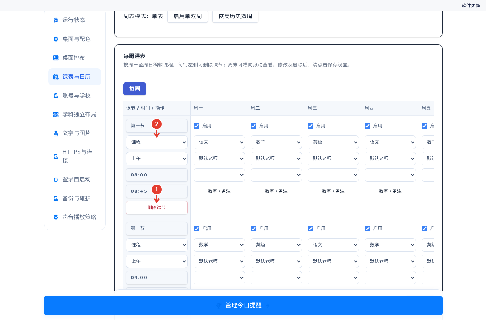
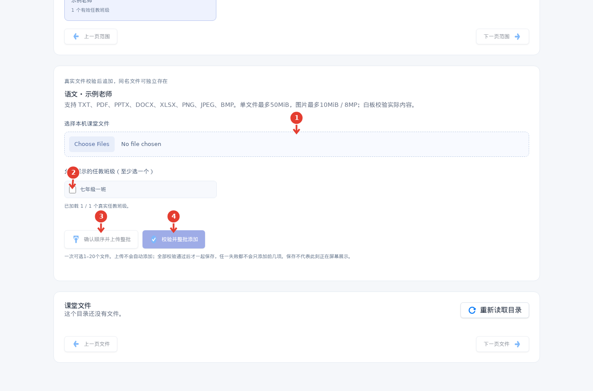
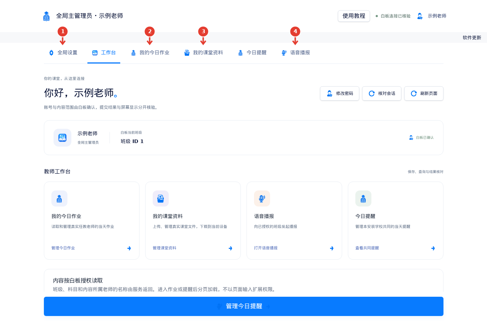
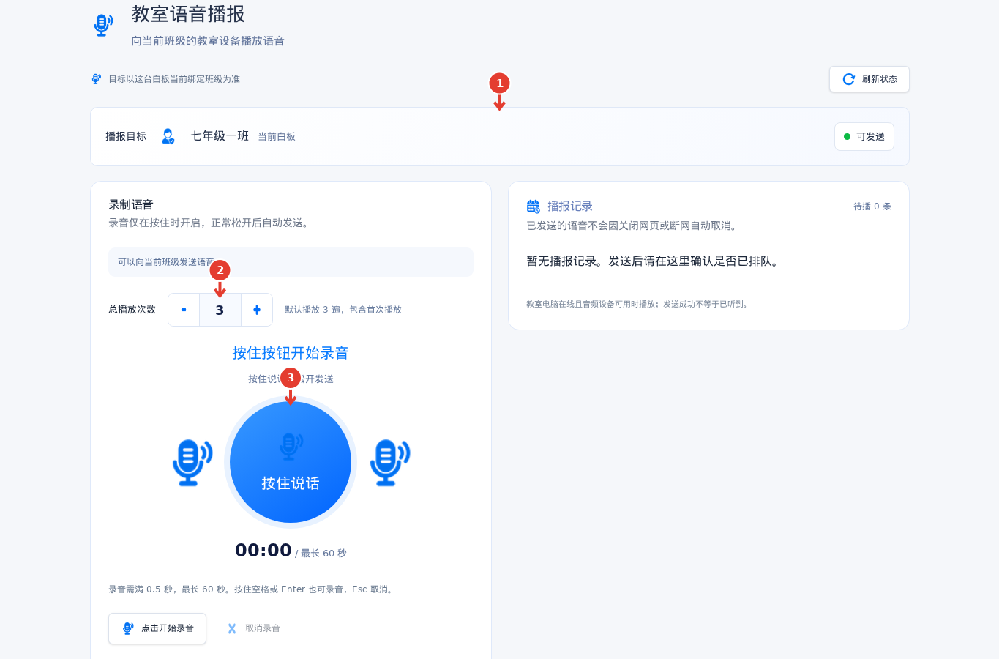
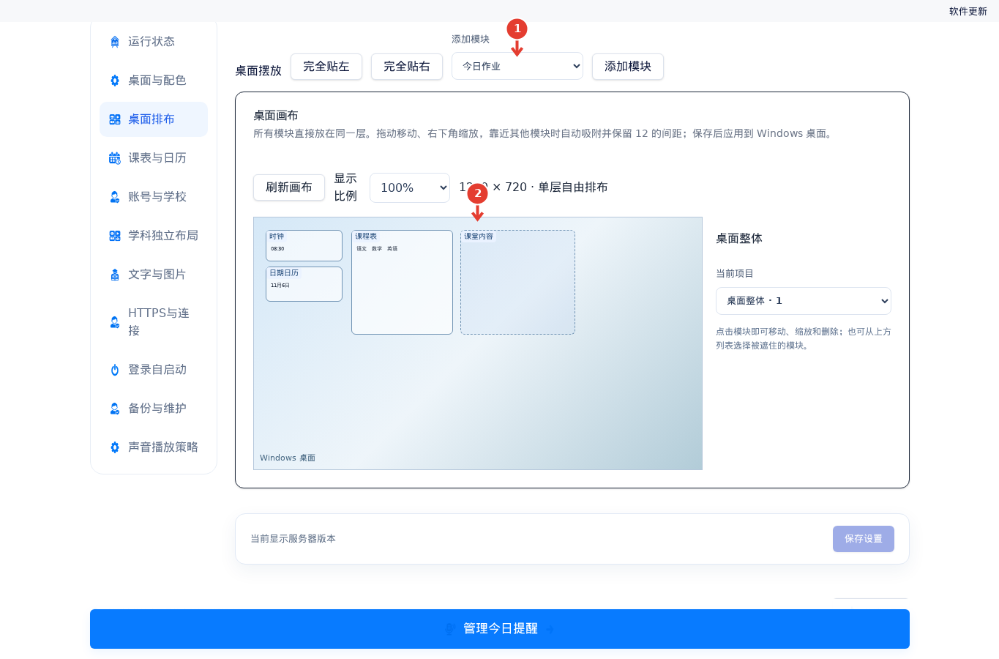
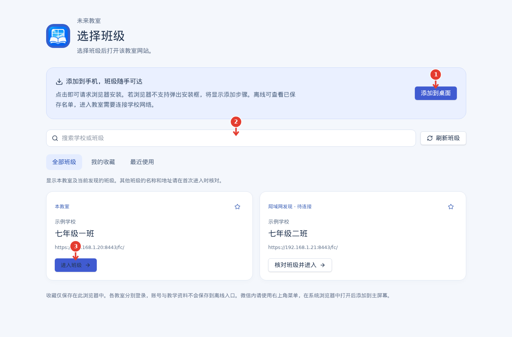
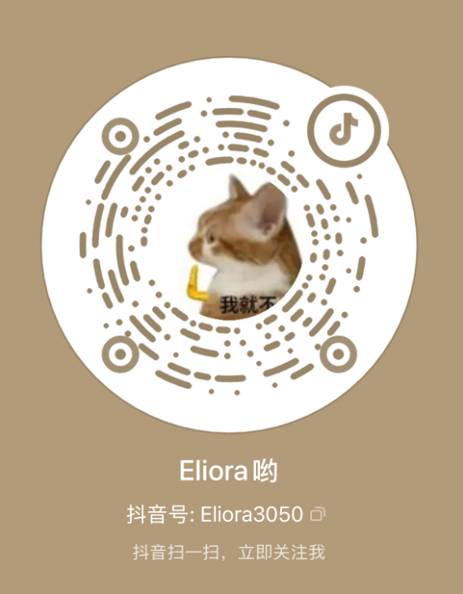

  
  <h1>未来教室</h1>
  
<strong>让课堂信息更清晰，让老师的日常工作更便捷。</strong>

  
完全免费、简单易用的课堂桌面助手 · GPL-3.0 开源

  

    <a href="https://github.com/NevermoreN/future-classroom/releases/latest">下载最新版本</a> ·
    <a href="#快速开始">快速开始</a> ·
    <a href="#功能介绍">功能介绍</a> ·
    <a href="#关注与反馈">关注与反馈</a>
  

---

**未来教室**是一款完全免费的课堂桌面展示应用，为配备 Windows 教学电脑或希沃白板的教室提供清晰、实用的信息展示。课程表、作业、课堂资料和时间等信息可以直接呈现在桌面，帮助学生更直观地了解当天的课堂安排。

老师可以在办公室或其他校园内设备上管理任教范围内的作业和资料，也可以向教室发送语音。班主任完成基础设置后，日常课堂信息会随课表更新，减少重复操作，把更多时间留给教学。

## 功能介绍

以下图片来自项目内置使用教程，展示各功能的操作页面。

### 📅 **每日课表与调课**

设置学期和每周课表后，桌面会根据当天日期显示课程安排，支持单双周。放假、调休和补课可在校历中设置；临时换课时，也可直接使用桌面上的换课按钮。

### 📚 **课堂资料随手打开**

老师可以提前在自己的设备上上传课件和其他课堂资料，选择允许展示的班级。上课时，在教室桌面点击对应资料即可打开。

### 📝 **作业与课堂提醒**

任课老师可填写自己任教范围内的当天作业，让学生在教室桌面查看；班级提醒也可以通过网页管理。

### 🎙️ **校园内语音播报**

老师连接校园网络后，可用手机或电脑录制语音并发送到指定教室，方便联系班上的学生。

### 🎨 **自由布置教室桌面**

管理员可以调整课表、时钟、作业等模块的位置、大小和样式，打造适合本班教室的桌面。

### 📱 **手机扫码使用**

通过教室电脑托盘中的「快捷连接」扫码，老师可以在手机浏览器中选择班级并登录，也可按手机提示将入口添加到桌面。

### 🔄 **校园内自动更新**

在一台教室电脑上安装新版后，程序会保存并分享完整安装包。同一更新范围内符合升级条件的电脑可自动发现、下载并安装新版，随后继续分享，无需逐台分发安装包。

## 适合谁使用？

- **班主任或教室管理员：**设置班级、科目和课表，管理调课与桌面样式，为任课老师创建账号并分配任教范围。
- **任课老师：**在授权范围内管理本科目的课堂资料和作业，并使用语音播报等功能。
- **学生：**在教室桌面查看当天课程、作业和课堂提醒，及时获取课堂信息。

## 快速开始

项目**完全免费**。最新安装包约 **19.5 MiB**，下载一个 EXE，双击即可开始一键安装，安装完成后自动运行：

1. 前往 [GitHub Releases](https://github.com/NevermoreN/future-classroom/releases/latest)，下载最新版本的 `FutureClassroom-版本号-Setup.exe` 安装包。
2. 在教室电脑上双击安装包，按界面提示完成安装，程序会自动启动。

首次使用时，在打开的本机网页中创建主管理员，依次设置学校、班级、科目和学期课表，再为任课老师创建账号并分配任教范围。安装仅需两步，首次配置请跟随程序内的 **「使用教程」** 完成。

手机和教室电脑需要处于可互通的校园网络；首次连接时，请按学校管理员的说明信任教室提供的证书。教室电脑在线且音频设备可用时，老师才能向该教室发送语音播报。

> 当前版本为 [1.0.2.0](https://github.com/NevermoreN/future-classroom/releases/tag/v1.0.2.0)，安装包名称为 `FutureClassroom-1.0.2.0-Setup.exe`。已安装 1.0.1.0 的设备可通过兼容的自动更新接收本版；1.0.0.1～1.0.0.3 请手动运行新安装包直接升级。升级和修复默认保留已有设置与资料。

## 运行环境与说明

- **系统：**Windows 7 SP1 x86、Windows 10、Windows 11 为兼容目标，适用于配备 Windows 教学电脑的教室。Windows 7 和 Windows 10 未进行实机测试。
- **网络：**教师设备与教室电脑需要网络互通。校园内自动更新不依赖公网或域名；公共日历候选获取需要相应网络条件，调休也可手动设置并保存。
- **使用权限：**全局设置由主管理员管理；教师账号按分配的班级和科目使用功能。
- **实际验证：**当前版本已完成 Windows 目标构建及相关安装包核对，完整实机安装和多台电脑自动更新尚未实测。

## 关注与反馈

欢迎关注 **Eliora哟**，获取项目最新动态，也欢迎提出意见和建议。💬

<table>
  <tr>
    <td align="center"><strong>小红书</strong></td>
    <td align="center"><strong>抖音 · Eliora哟</strong> 抖音号：Eliora3050</td>
  </tr>
  <tr>
    <td align="center"></td>
    <td align="center"></td>
  </tr>
</table>

点击图片可查看大图。

遇到问题或有功能建议，也欢迎提交 [GitHub Issue](https://github.com/NevermoreN/future-classroom/issues)。

## 项目资料

- [开发计划与架构](开发计划/未来教室项目完整开发计划.md)
- [校内更新与分发方案](开发计划/30-校内协同更新与安全分发方案.md)
- [实施进度与验证记录](开发计划/10-实施进度与验证记录.md)
- [教师端开发说明](web/README.md)

## 使用许可

项目采用 **[GPL-3.0（GNU General Public License v3.0）](LICENSE)** 开源，授权范围包括：

- **可以：**免费使用、查看源码、修改、分享，以及用于商业用途。
- **分发时需要：**按 GPL-3.0 提供对应源码和许可证，保留版权及许可声明；分发修改版本时，以 GPL-3.0 授权，并说明所作修改。
- **仅自行使用时：**一般无需公开自己修改的源码。

具体权利和义务以 [GPL-3.0 许可证全文](LICENSE)为准。第三方组件仍适用各自的许可协议。

本次许可变更适用于以 GPL-3.0 发布的版本；此前按其他协议发布的版本仍按原有授权使用。
