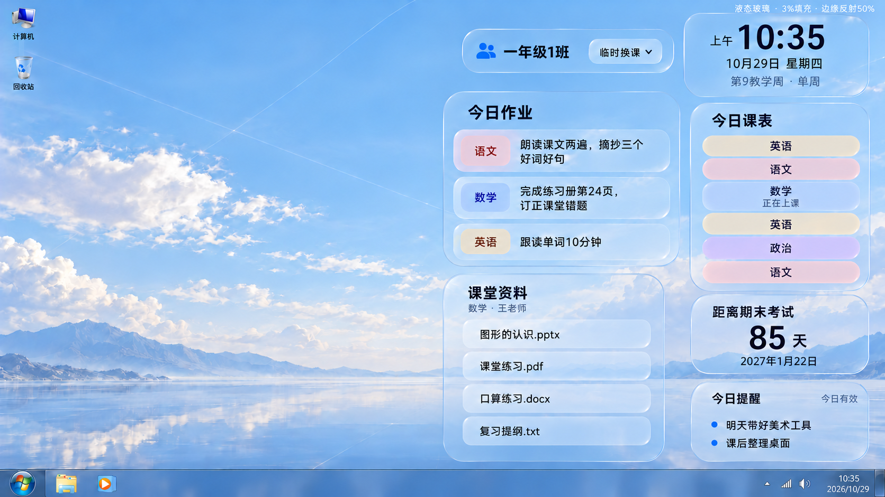
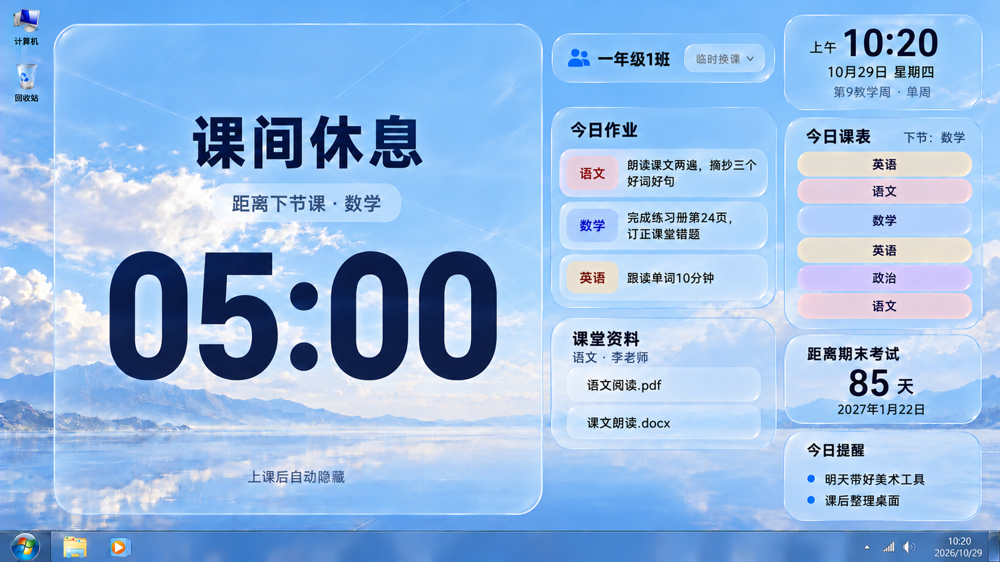
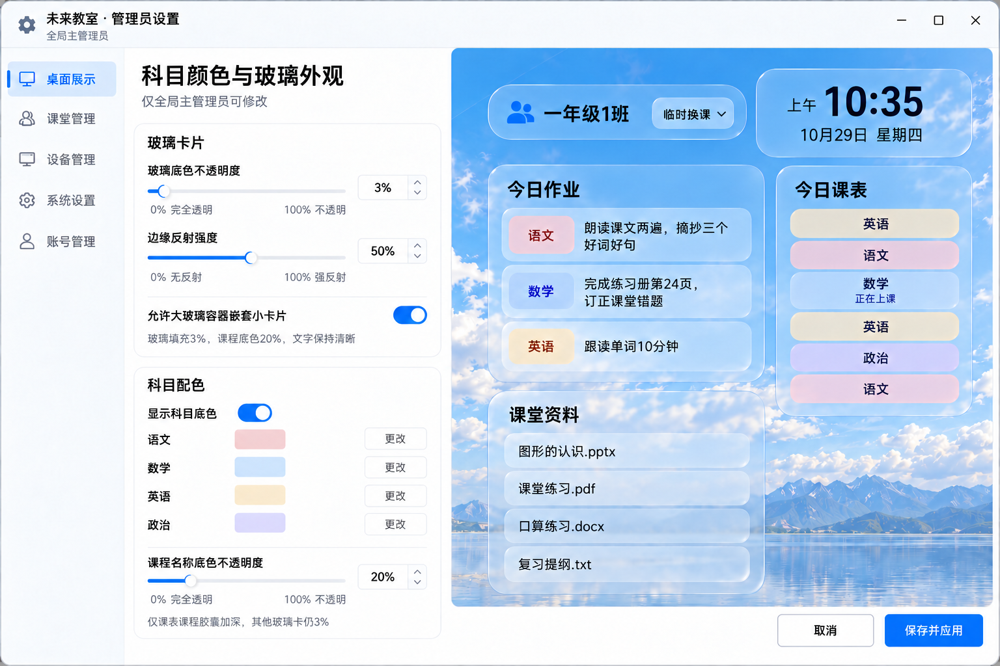
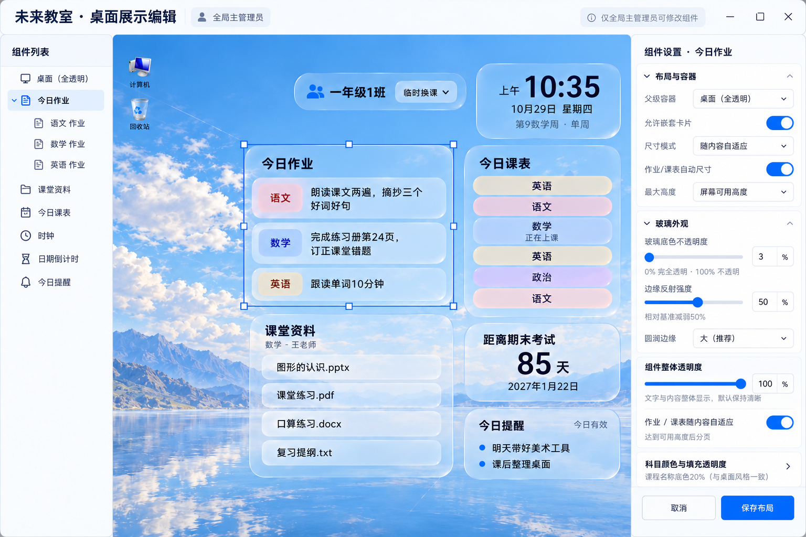
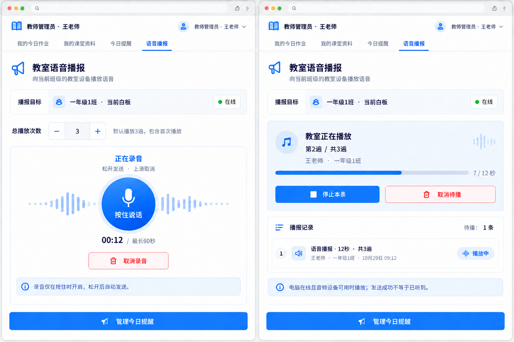

# 未来教室 · 最新图册

5张最终设计板、6个视图，使用内置imagegen。总计划1.16/D10；玻璃3%、边缘反射50%、课程底色20%，不表示程序已实现。

## 01 上课状态：左侧桌面留空

## 19 课间状态：倒计时占满右侧磁贴之外的桌面

10:20距下节数学10:25还有5分钟；课间继续显示上一节实际语文老师资料，10:25隐藏大卡并切数学资料/高亮。右侧不留计时空位，作业/课表/资料等保留原有排列；PPT前台展示层仍整体隐藏。

## 16 仅全局：颜色与玻璃参数

## 17 仅全局：组件树、嵌套与内容自适应

## 18 教师Web：录音与教室重复播放

四个入口为本人作业、本人资料、共同提醒、语音播报；语音限本人任教且本白板绑定班级，老师不能因此修改组件/布局。“播报记录”包含当前播放条目，待播1条为另一个队列计数；底部提醒入口不变。

[交互说明](03-界面交互与视觉规范.md) · [实际绘图记录](04-当前效果图提示词.md) · [完整视觉实施手册](../开发计划/模块/10-液态玻璃与内容权限.md) · [语音实施手册](../开发计划/模块/11-Web按住录音与本地语音播报.md) · [交付检查](02-交付清单与视觉核对.md)

Rust实施遵循[总计划D10](../开发计划/未来教室项目完整开发计划.md)及[Rust开发约束](../开发计划/07-Rust开发与验证计划.md)，本图稿的内容、权限、布局、视觉和交互范围保持。
