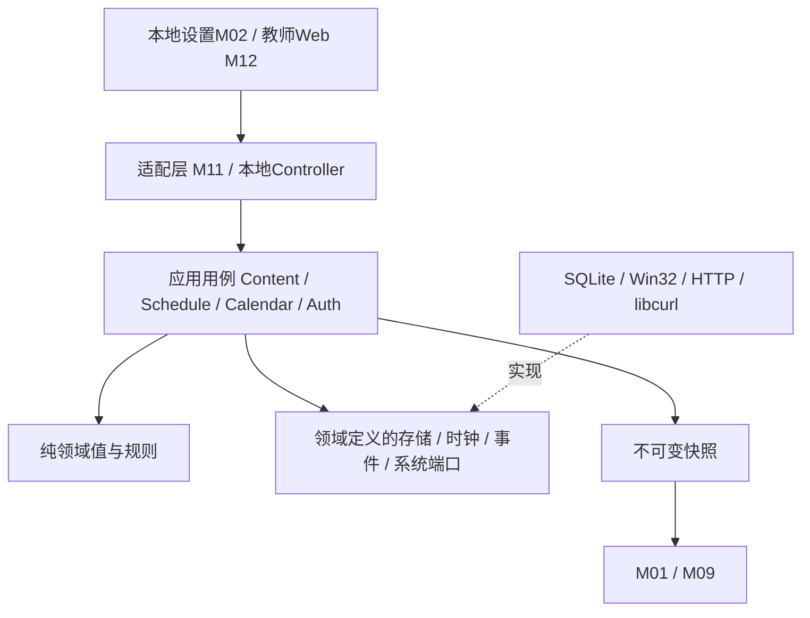

# 模块划分与接口契约

> 实施状态（2026-10-30）：用户已授权开始开发。本文保留 D11 设计基线；“仅计划、不开发/不测试/不同步”及“全部待实施”为历史状态，当前实现范围、证据与未完成门槛以[实施进度与验证记录](10-实施进度与验证记录.md)为准。

基线 D11，日期 2026-10-30。模块实现步骤见[导航](00-开发导航与需求追踪.md)，任务依赖见[任务清单](04-开发阶段与任务步骤.md)。最新角色、老师目录和本地打开见[文件实施手册](模块/08-三级权限与教师文件夹打开.md)。以下均是拟定开发契约。

## 1. 模块清单与数据所有权

| 模块 | 职责与主要接口 | 拥有的数据/资源 | 禁止越界 |
| --- | --- | --- | --- |
| M00 运行宿主 | Bootstrap、InstanceGuard、SystemEventRouter、ShutdownCoordinator | 消息循环、数据目录锁、会话与退出状态 | 不实现课程或渠道规则 |
| M01 窗口与绘制 | WindowFactory、VisibilityPolicy、OverlayController、WidgetRegistry | HWND、GDI/COM绘图资源、布局及科目视觉快照 | 不直接查询数据库、发网络请求或绕过权限 |
| M02 本地设置 | SettingsController、SettingsPageRegistry、DraftCoordinator | 未提交草稿、页面视图、预览窗口 | 不把控件值直接写数据库/注册表 |
| M03 认证授权 | AuthService、Authorize、CredentialStore、PairingPolicy | 口令验证信息、能力授权、会话及授权代次 | 不把本地管理员密码作为远程教师凭据 |
| M04 自启动 | AutostartService、SystemChangeCoordinator | 期望状态、系统实态、变更操作记录 | 不将注册表和数据库假装为同一个事务 |
| M05 内容资源 | ContentService、ResourcePipeline、ContentSlotCoordinator | 内容修订、槽位意图序号、受限解码任务 | 不让旧资源准备结果覆盖较新发布意图 |
| M06 本地存储 | UnitOfWork、Repositories、ResourceStore、BackupService | SQLite连接、附件文件、迁移/备份、命令日志与结果 | 不把附件字节塞入UI快照；不暴露数据库给浏览器 |
| M07 学期课表 | ScheduleService、ValidateSemester、CloneWeekPair、TimeRange | 基础表、双表、作息、角色、第一教学周 | 不依赖某个UI、网络或系统格式字符串 |
| M08 校历与教学日 | CalendarService、CalendarProvider、AcademicDayResolver | 学校模式/公共模式配置、各自映射、来源覆盖范围 | 不把补班日自动当成周一，也不跨模式补缺 |
| M09 时钟和倒计时 | ClockPresenter、LessonStateEvaluator、RefreshScheduler | 显示样式、当日状态与下次刷新点 | 不修改系统时钟，不每秒全屏重绘 |
| M11 局域网后端 | HttpHost、SessionMiddleware、UploadController、ApiRouter | HTTP请求队列、证书绑定引用、临时上传 | 不开放终端、任意路径、远程管理员设置入口 |
| M12 教师Web | TypedApiClient、PairingPage、PublishPage、DeviceStatusPage | 浏览器草稿、上传状态与服务端结果镜像 | 不保存服务端凭据；不自称内容已显示 |
| M13 诊断 | DiagnosticsService、RedactedLog、Metrics | 有界日志、计时和资源统计 | 不记录口令/恢复码/token及完整发布内容 |
| M14 构建发布 | 原生/前端构建、安装器、版本清单、清理检查 | 构建清单、包哈希、安装变更所有权 | 不把编译成功当真机兼容，不自动上传密钥 |
| M15 学校科目与教学配置 | SubjectCatalogService、TeachingAssignmentService、SubjectProfileService | 学校科目、班级任教关系、个人科目profile、学校科目配色及版本 | 不存认证口令，不按名称猜老师，不绕过M03/M06 |
| M16 课堂场景与当前节覆盖 | LessonSceneCoordinator、LessonOverrideService、SceneAssembler | 当前节覆盖、场景代次与公共/科目组合决策 | 不改基础课表或休息时长，不直接操作HWND |
| M17 本地资料启动 | OpenMaterialUseCase、LaunchCopyStore、WindowsFileLauncher | 当前场景打开校验、固定版本副本、启动动作结果及有界STA队列 | 不接受网页启动，不拼shell/任意路径，不把系统接受等同文件已显示 |
| M18 语音播报 | VoiceBroadcastService、BoundedVoiceQueue、AudioOutputPort/WinMmAudioOutput | 语音任务状态、重播计数、设备/缓冲与播放代次 | 不录教室麦克风、不调用外部播放器、不把入队当已听到、不自动重播崩溃任务 |

所有数据库写入经 M06 单写者调度；表格内容属于 M07，不意味着 M07 自己打开 SQLite。物理存储和领域所有权分开。

## 2. 依赖规则

M12 实际通过 HTTPS 调用 M11，不在浏览器里调用 Rust 原生代码。M02 在进程内调用应用用例。端口由内层定义、外层实现，依赖注入集中在 M00。诊断只能通过脱敏接口旁路采集，不能成为业务数据依赖。

## 3. 统一输入与结果

| 契约 | 必需字段与规则 |
| --- | --- |
| CommandEnvelope | commandId、可信origin(local/lan)、deviceId/classId、actor、capability、subjectId/profileId等目标、payload、expectedRevision、expiry、correlationId；origin不接受客户端自报 |
| ActorContext | 由可信适配层建立的本地窗口或已验证Web账号/教师会话身份；不接受前端自己声明管理员角色 |
| AuthorizationLease | principalId、角色、capability、class/subject/profile作用域、authGeneration、leaseId/有效期；接纳/读取/异步提交复核且不续闲置；实际副作用开始重新经HealthGate登记StartPermit |
| MutationResult | commandId、业务状态、committedRevision、错误码、可重试性、脱敏说明；显示状态另列 |
| ViewSnapshot | revision、settingsRevision、calendarRevision、ResolvedScheduleVersion、dayState、sceneGeneration、原课/有效科目/teacherId/profileRevision、提醒到期/可见性、科目配色/底色开关修订、布局约束、内容引用、visibilityGeneration；不可变且无原生句柄 |
| ResourceDescriptor | resourceId、媒体类型、实际字节/像素/尺寸、哈希、文件引用；不接受远程任意文件路径 |
| Role / TeachingAssignment | GLOBAL_ADMIN、TEACHER_ADMIN、USER三级；角色与任教关联独立，全局账号可兼任老师，用户不因残留任教关联获得写权限 |
| MaterialListSnapshot | classId、teacherId、subjectId、folderId/folderRevision、sceneGeneration、materialId/固定版本/displayName/addedSequence；只索引有界文件名，不加载缩略图 |
| OpenMaterialRequest / ActionResult | 仅可信本地主动；CURRENT_SCENE或OWNER_WORKBENCH上下文、materialId/resourceVersion/sceneGeneration/ResolvedScheduleVersion或工作台目录/requestId；动作结果与内容提交结果分开 |
| SubjectVisualPalette / SubjectBadgeDisplaySettings | 按稳定subjectId保存不透明RGB及配色修订；全局showSubjectBackground、subjectFillOpacityPercent及设置修订，关闭不删颜色；输入统一派生低饱和effectiveRgb；只允许本地全局管理写入 |
| SubjectVisualSnapshot | 同一次提交的配色/设置修订及按有效科目派生的低饱和填充/前景及按模式派生的描边；作业与课表共用，不由个人profile覆盖 |

命令状态：`RECEIVED → ACCEPTED → PREPARING → COMMITTED`；分支可终止为 `REJECTED / FAILED / SUPERSEDED / EXPIRED`。COMMITTED表示持久化完成，不表示此刻可见。视图状态为 `VISIBLE / HIDDEN_BY_APP / HIDDEN_BY_SESSION / RENDER_FAILED / PENDING_RENDER / REPLACED / INACTIVE_SUBJECT / HIDDEN_BY_COMPONENT / EXPIRED`。科目配置已保存但未到该科目课显示“已保存，上课时自动使用”，不误报正在显示或渲染失败；提醒到期与人为隐藏分别说明。

浏览器得到 ACCEPTED 只显示“处理中”，得到 COMMITTED 可显示“已保存应用”；若白板正在 PPT，显示“已保存，桌面恢复后显示”。Web响应失败不撤销已经提交的内容。物理断电可靠性还依赖文件系统和设备，不能宣称无限强保证。

结果查询同时返回本命令committedRevision、当前槽位修订、实际displayedRevision与状态时间。历史COMMITTED命令后来被新发布替换时，历史提交事实不变，但视图为REPLACED，不能因为屏幕上显示了较新内容就声称旧命令“正在显示”。授权吊销和写提交在同一串行裁决域按先后决定，已提交结果不会因之后吊销自动回滚。

## 4. 版本与并发

1. 所有本地/Web更新经过同一命令入口，数据目录只允许一个写者实例。
2. 学期与校历保存使用期望修订比较，两个草稿基于同版时先提交成功者获胜，后者返回 `REVISION_CONFLICT` 并提供刷新/重新编辑入口。
3. 每个内容槽位持久化单调 `acceptedSequence`，有效命令接纳时分配；异步附件完成时仅当仍为最新意图且授权有效才提交。
4. 新意图已接纳但资源准备失败，继续展示上次 COMMITTED 内容；较旧待处理任务保持 SUPERSEDED，不在新任务失败后偷偷复活。
5. 本地/Web交互均提交expectedRevision；冲突返回当前修订，由用户主动刷新核对，不自动覆盖。
6. 重试必须复用原 commandId；相同 ID + 相同负载返回原结果，相同 ID + 不同负载返回 `IDEMPOTENCY_CONFLICT`。
7. 内容槽以classId/subjectId/teacherId/日期等业务键隔离；作业按班级+日期+科目+ownerTeacherId，提醒按班级+当天，profile按班级+科目+老师，分别做修订，不能只用“文字/图片”全机槽。
8. 提醒命令只接受可信lan/Web origin，local包括主管理员请求也拒绝；到期状态在读取快照前过滤，跨午夜提交旧草稿拒绝。
9. 文件夹资料追加不使用“较新发布意图使旧任务SUPERSEDED”的单内容槽语义。有效并发添加均可形成独立MaterialRecord，在成功提交时分配addedSequence；删除/替换按folder/material修订检查，列表固定addedSequence倒序。
10. 桌面打开固定版本并带sceneGeneration，准备后复核当前课/资料发布和权限；切课/删除等失效则取消，不改开新行文件。教师本地工作台模式按本人任课目录/会话验证，可备课打开非当前课资料；模式由可信控制器建立，USER/网络不能伪造。

## 5. 课表与校历值类型

| 对象 | 关键约束 |
| --- | --- |
| SemesterConfig | start/endDate、firstTeachingWeekMonday、模式、revision；学期外返回学期未开始/已结束，不自动沿用周表 |
| TimeRange | beginMinute/endMinute，`0 ≤ begin < end ≤ 1439`；输入终点不能为24:00，均以分钟精度持久化 |
| WeekTable | tableId、角色single/odd/even、作息行和课程格；双表物理ID不同，逻辑行键用于明确同步作息 |
| SchoolCalendar | 有效起止、学校标识、来源、version、特殊日期；覆盖范围内未标记日回落常规表 |
| PublicCalendar | 分年份覆盖状态、候选/已采用版本、确认的教学映射；空年份不视为有效覆盖 |
| MakeupMapping | 目标日期、来源日期或明确weekday+周次/表角色；来源只解析基础课程，不递归应用日期覆盖 |
| ResolvedAcademicDay | 日期、状态NORMAL/REST/MAKEUP/UNCONFIRMED/OUT_OF_TERM、来源、表角色、具体作息及课程 |
| CourseCell / SubjectProfile | 课程格存subjectId、teacherSelectionMode显式/默认及对应teacherId；profile按班级/科目/实际老师唯一，引用folderId及文件名列表约束 |
| ClassSubjectDefault | classId+subjectId唯一、defaultTeacherId、revision；仅全局主管理员指定；显式课表格不受默认变动暗中替换 |
| LessonInstanceKey / Override | actualDate/classId、ResolvedScheduleVersion、实际begin/end；覆盖仅当前COURSE有效，比较实际/源学期与映射全部版本，独立修订/终止记录不复活 |
| ResolvedScheduleVersion | actualSemesterId/revision、sourceSemesterId/revision、calendarMode/appliedCalendar/makeupMapping修订、sourceTableId/sourceRowId及规则版本；任一变化重算，单学期也使用同一类型 |
| SharedReminder | 班级当天槽、text/revision/expiresAt/status；次日零点为排他上界，清空/到期从展示布局移除 |

学校模式缺失/超覆盖返回 UNCONFIRMED；普通时钟仍运行。公共模式未知年度不冒充已核对节假日，可显示常规周课表并注明“调休资料未核验”，仅已知未确认补班日暂停其课程高亮/休息计时。此区分必须在状态对象中表达，不能靠一个布尔 isHoliday。

## 6. 错误分类

| 错误 | 行为 |
| --- | --- |
| AUTH_REQUIRED / FORBIDDEN / AUTH_EXPIRED | 不接纳写入；草稿可保留，重新授权不会自动提交 |
| INVALID_TIME / OVERLAP / INVALID_WEEK_ROLE | 返回表/行/格定位；整体不写入 |
| REVISION_CONFLICT / SUPERSEDED | 不覆盖新修订；不得无条件自动重试变更 |
| RESOURCE_TOO_LARGE / INVALID_MEDIA / QUOTA_EXCEEDED | 停止处理并清理本任务临时文件，保留旧有效内容 |
| STORAGE_UNAVAILABLE / DISK_FULL | 不报告提交成功；Web返回可理解的存储失败及原命令查询入口 |
| CALENDAR_UNCONFIRMED / SOURCE_UNAVAILABLE | 区分教学日待确认与资料下载失败，遵循所选模式 |
| SYSTEM_CHANGE_PENDING / SYSTEM_CHANGE_FAILED | 显示系统实态，记录补偿/恢复任务，不伪造设置成功 |
| CHANNEL_UNAVAILABLE / DEVICE_OFFLINE | 明确无投递保证；本地内容继续 |
| SUBJECT_IN_USE / SUBJECT_DISABLED / TEACHER_ASSIGNMENT_REQUIRED | 阻止直接删引用科目；多老师需明确指定，资料/配置缺失使用中性占位 |
| SCOPE_FORBIDDEN / CHANNEL_NOT_ALLOWED | 禁止跨科目/老师/班级访问；仅Web提醒不可由本地旁路提交 |
| LESSON_CONTEXT_CHANGED / NOT_IN_LESSON | 临时换课已越界、课表/校历变化或休息午休，拒绝且不顺延到下一节 |
| REMINDER_DAY_CHANGED / REMINDER_EXPIRED | 昨日草稿不自动发到今天；到期提醒不返回正文、不重新展示 |
| MATERIAL_REMOVED / FOLDER_REVISION_CONFLICT | 刷新列表，不能按旧行号操作；目录/其他老师资料不受影响 |
| ASSOCIATION_MISSING / LAUNCH_FAILED / OPEN_COPY_QUOTA | 提示关联软件/启动/空间原因，不自动安装、提权或强关外部程序 |

## 7. 存储与外部系统的边界

本地配置事务只能覆盖本地数据库状态；注册表、自启动、HTTP.sys绑定、证书和防火墙操作使用持久化操作记录、读回核对与补偿，不称为跨系统原子事务。附件则先验证并提交文件，再事务化切换引用；孤立文件可回收，已引用有效文件不可抢先删除。

依据：[SQLite 原子提交的范围](https://sqlite.org/atomiccommit.html)与[HTTP API 系统配置权限及持久性](https://learn.microsoft.com/en-us/windows/win32/http/setup-configuration)。工程流程是本项目设计，实际恢复能力仍需 Q11 故障测试。

## 8. 科目颜色与时间页脚边界

M15拥有学校配色规则，M02协调全局底色设置，M06联合条件提交，M16合成同版本快照，M01用共享色解析器绘制作业标签及无数字、名称居中的课表胶囊，M11/M12只读返回相应预览。当前课状态文字独立；配色时无边框，关闭底色时可描边，配色模式仅保留状态文字且无描边，无底色模式保留柔和边框/可加强当前课边框。课表桌面视图不输出时间页脚，但M07的TimeRange与M09计时完整保留。契约细则见[科目视觉手册](模块/09-科目配色与简洁模式.md)。

显示矩阵为FILLED（低饱和全填充、strokeWidth=0、当前课同样0）和OUTLINED（透明填充、柔和描边）；课程名按胶囊全宽居中。课时行ID/排序键保留在业务模型，仅展示层移除序号。重复科目保留独立行，不按名称合并；几何与最终颜色由同版快照派生，不把旧的当前课金框叠加到填色分支。

R30布局及透明度：SubjectBadgeDisplaySettings追加subjectFillOpacityPercent（科目标记默认3，仅填充）；组件布局追加componentOpacityPercent（默认100，整体）。均0–100，组件整体缺省100；新玻璃/科目标记缺省3、课程覆盖20、反射50；快照携带同版值。填充Alpha只乘一次底色Alpha与组件/祖先整体Alpha，文字不乘底色Alpha；FILLED即使底色0%仍strokeWidth=0。组件0%展示输入区清空，但编辑控件和逻辑布局仍保留。布局以作业主列、资料窄列求解，细则见视觉手册第6节。

## 透明根、材质与内容写权

LayoutTree/GlassMaterial由全局拥有：root背景固定0，glassSurfaceOpacityPercent=3、edgeReflectionStrengthPercent=50、coursePillFillOpacityPercent=20，科目标记默认3/组件整体默认100。父玻璃填充不当成后代group alpha，绘制树有界/无循环，全部组件结构/颜色/透明度写命令仅全局。

HomeworkEntry含稳定homeworkId/ownerTeacherId，教师只写本人且有效任教范围；SharedReminder仍按class/date修订，但允许启用教师/全局共同维护同安装学校所有受管班级，不限作者。Profile布局设置仅全局，旧命令/配对/恢复不得复活教师管理权；教室桌面临时换课/恢复原课通过独立公开本机用例执行，不复用或伪造管理员会话。详见[完整契约](模块/10-液态玻璃与内容权限.md)。

AutoSizePolicy由全局配置；M16用同版内容/字体/DPI/布局树单向测量作业/课表并生成Rect，仅为允许的正文、文件名和明确按钮生成命中区；课程表、时钟、日历/日期倒计时纯展示且无点击/翻页输入，超限走尺寸或容量诊断。M01只消费已验证快照。允许的正文分页/只读查看不等于修改组件，长内容不能无限扩大。renderCapability区分BASIC_GLASS/AERO_GLASS/受限回退，不把图稿当兼容证据。

## 课间大字显示契约（1.17/D11）

M07拥有REST的restPurpose（RECESS/LUNCH/OTHER/UNKNOWN）、同分区课程关系和实际日期deadline；M09计算remainingSeconds，不按计时器逐次减一。RecessViewState含status、actualDate、rowId/nextLessonId、deadline、remainingSeconds、captionKind、scheduleRevision及sceneGeneration。captionKind区分NEXT_LESSON与REST_END，不把活动称作上课。

M02持久化全局RecessDisplaySettings（enabled默认true、remainingDesktopAnchor、数字字体/颜色及尺寸约束），教师写入拒绝；M16合成逻辑显示条件与剩余桌面大卡，M01再与桌面可见性相与。M01绘制前复核deadline/代次；上课/非课间无卡片、间距和命中区。根层仍无焦点/透明穿透，任何业务计时更新不得改变前台避让。计入既有8个顶层上限；先布局右侧常驻卡并扣除保护区，再将大卡放大到剩余连续区域；小工作区不裁剪数字或覆盖右侧内容。旧REST用途不明保留并待全局确认，不猜午休。详见[课表手册第9节](模块/04-课表双表校历与倒计时.md)。

## 语音与课间资料契约

VoiceBroadcastSubmit独立于资料打开/文字单槽命令；repeatTotal为含首次的总次数，默认3、范围1–10，音频限规范PCM16/16kHz/单声道WAV及0.5–60秒。VoiceAsset/VoiceBroadcastJob归属服务器可信owner与绑定白板/班级，队列最多4条、本人2条；M03接纳/每遍开始/撤权事件检查权限，教师仅本人任教且白板绑定班级，全局可管理全部。提交COMMITTED与QUEUED原子落地；PLAYING/COMPLETED是独立声音动作状态，不复用displayState。上传/入队不证明听到，停止reset返回的缓冲不计自然完成。

LastLessonMaterialContext含actualDate/classId、sourceLessonKey、ResolvedScheduleVersion、实际subjectId/teacherId/folderId及最终有效覆盖区间证据。仅BREAK_PUBLIC使用该上一课目录并保持实时目录修订/倒序；课间不加载上一科视觉profile，也不提前用下一节目录。ViewSnapshot追加materialSourceKind=CURRENT_LESSON/RETAINED_BREAK/NONE及materialContextKey；当前COURSE字段仍为空，不能伪造正在上课。M17的CURRENT_SCENE打开接受同版已发布的RETAINED_BREAK文件，复核teacher状态/资料版本/代次；上课、删除、撤权或改表使旧打开准备失效。完整状态和权限见[语音手册](模块/11-Web按住录音与本地语音播报.md)与[目录手册](模块/08-三级权限与教师文件夹打开.md)。

## Rust 端口与序列化约束（D11）

crate依赖方向以[Rust开发计划](07-Rust开发与验证计划.md)为准：应用只依赖domain/ports，数据库连接和文件准备在外层，bootstrap负责组装。回调端口用有界消息和拥有数据的Result；跨线程值必须自然满足Send/Sync，不给HWND/COM强加Send。CommandEnvelope/结果查询的JSON字段、数字枚举、日期数组/正文UTF-8和原有payload digest需设计版本兼容样例，不因Rust命名习惯改网络或持久格式。

Rust所有权、锁和Arc只解决资源/内存的一部分：授权lease、expectedRevision、scene/visibilityGeneration、COMMIT后发布及到期读过滤仍逐阶段复核。DocumentStorePort writer回调不得重入任何writer，after_commit权威交换失败按HealthGate全局FAULTED，敏感读与副作用同样拒绝。布局/语音/文件打开等动作仍保持独立业务终态，不以Rust函数Ok直接声称可见或已播放。

## Rust运行权威、动作和原生资源

| 对象/端口 | 权威持有方 | 必须满足的契约 |
| --- | --- | --- |
| HealthGate/AuthorityStore | fc-runtime实现，Writer持唯一Publisher，各执行域持Reader | AUTHORITY_UPDATING阻新敏感开始；COMMIT后权威交换失败转不可逆FAULTED，旧权限读/下载/打开/播音/展示/写都拒绝 |
| StartPermit | 实际执行域开始前登记 | 绑定actor/scope/authEpoch/healthEpoch/job generation；排队许可不能直接开始，已不可撤回动作单独记录 |
| IoSlot | HTTP执行域 | 对齐固定RequestBuffer/OVERLAPPED/响应数据，完成前不移动/扩容/释放，取消后drain，旧完成只结算原槽 |
| WaveBuffer | Audio执行域 | 固定WAVEHDR/PCM/事件；归还且unprepare成功后才能释放，取消DONE不计完整遍数 |
| ArchiveBudget | Materials执行域 | 按实际展开字节/条目/XML事件/时间和8MiB流缓冲合计限制，不按压缩输入或声明长度代替 |

所有权、失败/释放次序及具体额度以[所有权与FFI协议](08-Rust所有权与FFI生命周期.md)为唯一公共契约。crate职责/依赖见[Rust工程拆解](07-Rust开发与验证计划.md)，构建与实际运行证据见[构建门槛](09-Rust构建验证与发布门槛.md)。业务模块仍为18个，12个生产crate承载这些模块，并不新增业务功能。
