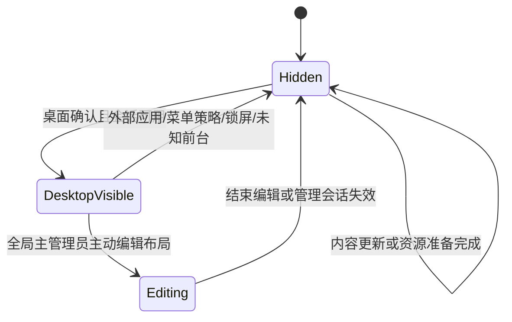

# 功能链与状态机

> 实施状态（2026-10-30）：用户已授权开始开发。本文保留 D11 设计基线；“仅计划、不开发/不测试/不同步”及“全部待实施”为历史状态，当前实现范围、证据与未完成门槛以[实施进度与验证记录](10-实施进度与验证记录.md)为准。

基线 D11。统一结果语义见[接口契约](01-模块划分与接口契约.md)，具体程序调用见[调用链](03-调用链与线程模型.md)。Fxx 是本文功能链编号。新增规则详见[多科目手册](模块/07-多科目联动与临时课堂.md)。

## F01 启动、恢复与退出

```text
手动/登录启动 → 解析固定参数 → 获取数据目录排他锁
→ 已有实例：只请求现有入口，不开第二条连接；跨会话不抢桌面
→ 获取锁：检查初始化/凭据状态 → 校验存储/迁移 → 恢复最近有效修订
→ 创建隐藏宿主/托盘 → 当前会话与前台状态采样 → 仅允许时显示
→ 按开关恢复Web模块 → 后台回收孤立临时文件
```

首次运行创建主管理员账号；创建成功后不再开放公开管理注册。学校科目/任教/课表配置可稍后继续；未完成授权不开放远程写入。ProgramData/数据库/凭据损坏进入修复，不当成全新安装。启动先清除过期提醒，再发布首个可见快照。退出先停止接收再取消后台任务，不无限等待网络。

## F02 桌面显示与应用避让

状态优先级：`STOPPING > SESSION_HIDDEN > EDITING/SETTINGS > APP_HIDDEN > DESKTOP_VISIBLE`。本应用设置前台不是“桌面前台”，展示层仍隐藏；进入布局编辑由显式授权状态单独显示编辑视图。



恢复前采样第二次；若前台已切回 PPT，丢弃过期显示请求。识别未知窗口默认隐藏。Web更新、倒计时和Web请求恢复只能更新业务状态，不能调用“显示并激活”。菜单和 Explorer 重建由 P0 真机确定具体识别规则。

## F03 设置、权限与系统变更

1. 查看非敏感状态不需解锁；写操作建立管理员会话。
2. 页面编辑草稿、定位校验、预览；取消不提交。科目底色开关和学校配色由本地全局管理员配置，联合比较设置/配色修订后保存。
3. 保存时重新鉴权、比较 expectedRevision；数据库内配置一次提交。
4. 自启动/网络系统配置保存为操作记录，执行系统变更并读回；失败返回具体实态和恢复操作，不把“期望已写入”当“系统已完成”。
5. 密码修改/恢复/锁屏使旧管理会话失效，待处理敏感任务在提交点重新检查；草稿保留但不自动应用。

失效凭据恢复为独立本地流程；恢复完成轮换恢复码、会话和教师授权，Web配对在重新确认之前保持停用。系统管理员的文件控制能力不在应用口令可防御范围。

## F04 文字、图片和分页图片发布

```text
本地/Web输入 → 建立可信身份 → 校验能力/目标/有效期
→ 统一接纳并分配槽位意图序号 → 准备文本或受控导入或上传/解码资源
→ 核对最新意图、授权代次及期望修订 → 原子提交内容引用/版本
→ 发布快照 → 按可见性刷新或等待回桌面 → 返回持久化与可见性两种状态
```

分页图片是有序资源清单和当前页，默认静态翻页；若采用定时轮播，需额外明确间隔和刷新预算，不能暗中新增动画循环。清空内容位、撤销和翻页均作为新命令，旧资源按引用回收；撤销必须明确目标修订，不能撤销到另一位教师刚发布的新版本。

新发布失败保留上次有效内容；同槽位旧准备任务不得迟到覆盖。上传完成和网页收到200都不是“屏幕已显示”的证据。

## F05 表格课表与单双周

```text
解锁 → 新建学期/班级/起止日/第一周锚点
→ 确认学校基础科目已建 → 添加上午/下午作息行 → 原数字时间控件
→ 各课程格选择subjectId/任课老师，活动行单独填写 → 填各星期安排
→ 校验基础表 → 不用单双周则保存统一表
→ 使用单双周则复制成A/B两份 → 各自编辑 → 指定odd/even角色
→ 可选同步作息 → 校验全部启用表 → 预览日期 → 一次提交学期修订
```

基础表复制保留文字/备注/课程/时间，不共享可变容器；A/B ID不同。重新打开编辑不再次复制。启用/关闭单双周、交换角色、同步作息均是草稿操作，点击保存才发布；目标表时间冲突时整次同步不应用。

## F06 学校校历模式

启用前必须有匹配学校、当前学期及覆盖范围的有效配置。流程为：配置学校来源/范围 → 日历界面填写特殊日期 → 补课日指定基础来源日期或表角色 → 预览 → 提交开关与版本。

解析：学期内的显式临时覆盖 → 学校特殊日期 → 覆盖期内普通周课表。学校假期优先；学校日历普通空白日不是“资料缺失”。超覆盖/损坏返回待确认，不自动改用国家日历。学期外直接显示未开学/学期结束。

## F07 无学校校历的公共调休模式

开关关闭即可使用，不要求先建立完整学校校历。获取官方依据/可替换候选源 → 校验年份/日期/来源 → 对比本机已采用版本 → 管理员确认放假和补课映射 → 保存 → 当天自动执行。

普通未确认候选不覆盖已采用版本；空年度显示资料未核验，不伪造“该年无调休”。补班日期已知但课程未确认时，该日课程和休息计时待确认；一般普通日仍可按常规表并显示资料状态。学校寒暑假可由学期起止和管理员日期覆盖表达，不因没有完整校历要求老师每天确认。

模式切换：先预览受影响日期，保存开关和被选版本，重算今日。两套映射隔离保留；导出备份/恢复也须保留模式归属。下载失败仅改变源状态，不能偷偷切换模式。

## F08 教学周、当天状态和休息计时

```text
墙上日期 → 学期边界 → 模式解析 → 有效教学日/映射来源
→ 原子读取实际/来源学期及映射的ResolvedScheduleVersion → 根据源第一周锚点选单双表 → 当前格及有效作息
→ 课时/休息/活动/空闲状态 → 高亮与休息目标时间
→ 计算剩余秒数 → 局部刷新 → 预约下一边界
```

本机当前日期永远是今天，补课来源日期只用来取课表和教学周；不能把系统“今天”改成被补日期，闹钟/倒计时截止仍用实际日期。

日期来源跨周时沿用被补日期的单双，不递归追踪来源日的再调休；来源不属于任一已配置且唯一可解析的启用学期或基础表不存在须报错。休假默认不改变周次自然递增。空课程格、集体活动、午休不误判为正在上课；同分区未被其他作息占用的空档才可自动推断休息。

剩余时间使用实际截止减当前时间并向上取整；课时区间为 `[开始,结束)`，边界先更新状态，不显示负数。隐藏时不绘制，唤醒/改时重算；开表盘秒针和休息计时共用1Hz调度。

桌面课表不再绘制底部当前课时时间范围；管理员时间列与上述解析/计时照常使用完整作息。

## F09 三种日常时钟

设置选择 Digital12h / Digital24h / Analog → 保存 → ClockState读取本机时间 → 样式渲染。12小时中文上午/下午，午夜为上午12点、中午为下午12点。样式切换不影响24小时课表输入和剩余时长；分钟/秒刷新规则独立于课程边界任务。

## F11 局域网授权与Web发布

管理员配置证书/授权网络并启用 → 打开短期配对窗口 → 教师浏览器访问静态页 → 配对申请 → 本地管理员批准 → 限权会话 → 上传/预览 → 带幂等ID和期望修订提交 → F04 → 查询执行结果。

老师不在教室时日常发布无需再次本地批准；首次配对需部署时完成。撤销教师使未提交写入失效；查询/草稿不获得本地管理员权限。白板关机时无接收端，页面明确失败；校外先有校园VPN等可达通道。Web首版不提供课表写接口。

配对必须绑定已有教师账号和任教范围；网页维护本人作业、本人任教科目资料、本安装学校范围全部当天提醒及授权任教班级语音播报，不能改基础课表/校历/全局系统设置。提醒写入口仅Web，流程见F16。

## F12 故障恢复与发布

任务中断 → 启动检查已提交状态/命令日志/系统变更记录 → 失效过期授权与请求 → 安全重试未终止任务 → 扫描未引用资源 → 当前快照恢复。已提交结果不因Web响应丢失回滚。

升级先备份/停写，再检查数据迁移与前后端版本，失败回到兼容版本或恢复兼容备份；不能仅替换exe便声称回滚成功。后续代码同步由用户另行安排；当前仅维护本地计划。正式首版发布仍等待P1–P4/P6及全部P5门槛。

## F13 主管理员、基础科目与任课关系

部署工具准备ProgramData子目录/ACL → 首次创建主管理员及恢复码 → 学校/班级 → 基础科目表 → 创建教师必选任教科目和班级 → 课表下拉选择并关联老师。已被引用科目不能直接删除；停用需列明影响并由主管理员修复关联，历史保留稳定ID。

身份生命周期为 `ENABLED → DISABLED/GRANT_CHANGED`，改变任教关系推进授权代次；最后主管理员不可删除，交接原子转移。Web身份绑定同一已有principal，不按昵称授权。

## F14 科目profile与自动课堂场景

教师管理员登录 → 读取授权班级/科目 → 添加受限资料 → 原件/目录索引提交并按加入序号倒序 → 仅修改本人内容 → 校验所有权和修订 → 提交资料；布局/设置由全局单独维护 → M16重算当前老师目录场景。

场景状态为 `CLASS(subject,teacher,profile)` / `BREAK_PUBLIC` / `LUNCH_PUBLIC` / `ACTIVITY_PUBLIC` / `IDLE_PUBLIC` / `UNCONFIRMED_PUBLIC`。进入CLASS才应用科目profile；离开时清除私有布局引用，回公共状态；BREAK_PUBLIC只保留上一课实际老师的资料目录，下一课开始才切换资料来源，休息/午休时间规则不变。共享提醒和当天全科作业独立合成；旧准备结果不能覆盖新场景。同一SubjectVisualSnapshot驱动作业标签和课表胶囊底色；临时课按有效subjectId取色，当前课状态文字独立；仅无底色模式可描边。

## F15 当前节临时换课

任何人主动点击桌面顶部按钮（无需账号、登录、口令或身份验证） → 列出学校启用科目 → 选目标老师（多人必选） → 带当前LessonInstanceKey和覆盖修订提交 → 复核当前仍在该COURSE → 持久化覆盖 → F14原子替换布局/设置/资料。恢复原课使用同一公开本机入口；操作来源记录为LocalDesktop，不伪造管理员身份。

覆盖状态 `ACTIVE → RESTORED / EXPIRED / INVALIDATED`。结束/下节/改表/目标失效后不能复活；休息、午休、无课拒绝。基础表不变、课时不顺延；界面标“临时/原科目/本节有效”。重启在有效节内可恢复，时钟回拨不复活已终止记录。

## F16 Web日提醒、到期与全部磁贴补位

```text
教师Web任意页底部“管理今日提醒” → 目标班级当前日期/当前版本
→ 编辑 → 发送/清空 → 校验可信Web来源、同安装学校范围和当天上下文
→ 提交前复核日期/版本 → 保存到期为次日零点 → 合成提醒可见性和响应式布局
→ 前台允许时展示，否则仅保存，回桌面再取有效快照
```

`EMPTY → ACTIVE → CLEARED / EXPIRED`；非空新发送产生新的ACTIVE。23:59:59仍有效，次日00:00:00失效并清除活动正文；启动/唤醒/读取也检查，不依赖定时器绝不漏触发。跨午夜旧草稿拒绝；磁盘不可写也先从展示排除过期正文，物理清理待重试。清空/到期不留空框，课表上吸；新提醒恢复。全部磁贴依据约束统一重排，无持续动画或无限缩字。拒绝local提醒写命令，即使是主管理员。

## F17 三级权限、任课关联与老师目录资料

全局主管理员创建/分配角色 → 教师管理员必选任教范围；全局账号可兼任教学，用户只读 → 指定班级/科目默认老师或具体格实际老师 → 上传/本地导入受控老师/科目目录 → 原件验证并提交索引/新增序号 → 文件名按新增序号倒序展示。

资料不是覆盖型单槽；有效并发添加形成独立条目，不让慢上传被另一个新增文件SUPERSEDED。添加/删除经owner/科目/班级/角色校验，按ID和修订裁决；打开、下载和改mtime不改变排序。当前节实际或临时老师决定取哪个目录，换课整包替换目录与布局，不保留上一位老师文件名。

## F18 文件名主动点击、本地打开与返回

文件名行点击（用户只读亦可） → 当前课发布可见性+sceneGeneration+资料固定版本 → 受限准备打开副本 → 复核场景/账号/资料未删除 → M17系统关联open → 返回动作结果 → 外部应用前台统一隐藏 → 回桌面重取当前老师目录/提醒并恢复。

只打开用户主动选择的白名单本地资料，不远程执行。无关联、被删除、换课、配额不足或用户取消分别反馈；LAUNCH_REQUESTED不证明已显示。启动不参与崩溃恢复重放；打开后删除源不强关正在用的PPT，副本按占用/租约清理。文件行之外仍穿透，休息午休公共规则不变。

科目视觉细化沿用F03/F08/F14/F15：统一配色可编辑、底色可关闭，取消保留原版，关闭不删色值；课表名称居中、无节次数字，填色模式无边框，关闭时柔和边框；不增加业务时间删除或远程全局设置入口。详见[科目配色手册](模块/09-科目配色与简洁模式.md)。

R30沿用现有布局/设置链：加载组件布局与科目填充Alpha → 有权草稿修改/合并预览 → 范围/修订校验后保存 → 同版场景重新测量作业优先/资料窄列 → 按填充与整体Alpha合成 → 更新展示输入区。0%组件不截获输入，编辑器列表仍可恢复；取消还原已保存值，透明度不改课程身份或提醒有效期。详见[视觉手册](模块/09-科目配色与简洁模式.md)第6节。

F03仅全局修改任意组件/层级/材质；F14教师只提交本人内容、全局profile仍控制展示；F15教室桌面换课/恢复原课公开免登录，基础课表编辑仍须全局本地；F16提醒写授权放宽到本安装学校全部受管班级（不限作者）但保持仅Web/当日/修订。内容变化触发透明根下独立玻璃卡的单向测量与原子重排，作业所有者进入命令校验。完整状态边界见[玻璃与权限手册](模块/10-液态玻璃与内容权限.md)。

### F08增补：课间大卡自动显示/关闭

```text
课时边界/启动/回桌面/唤醒/改表 → 同版当天作息重算
→ 有效课间且全局启用 → 准备剩余桌面大字RecessViewState
→ 桌面可见：加入公共布局并原子重排；PPT/锁屏：SUPPRESSED，停止秒绘制
→ deadline到达先重算 → 上课/活动/午休/放学：移除大卡及间距 → 恢复对应布局
```

INACTIVE不占位；ACTIVE每秒局部刷新；SUPPRESSED只有逻辑状态，不弹窗抢焦点，恢复前再次判定。默认自动启用、静音，数字按右侧既有磁贴之外的剩余工作区尽量放大，1080p参考220–300DIP；无当前课高亮的课间可标“下节”，活动前只标休息结束。午休REST明确LUNCH、用途UNKNOWN待确认；临时换课不改变边界。细则见[课表手册第9节](模块/04-课表双表校历与倒计时.md)，功能链编号不增加。

## F19 Web语音录制、排队和本地重播

```text
可信HTTPS/教师登录 → 目标白板和任教班级确认 → 总次数默认3
→ 按住获取麦克风/采集 → 上滑/取消/失焦则丢弃并释放
→ 正常松手：停止采集 → WAV归一化 → 受控上传
→ 同commandId提交播报 → 鉴权/格式/配额 → QUEUED原子保存
→ 单播放流逐条取任务 → 每遍前复核 → PLAYING → 完成一遍/间隔1秒
→ 共repeatTotal遍后COMPLETED → 原生归还/unprepare成功/关闭设备后回收正文；Web查询实际状态
```

本人/全局停止或本地紧急停止先终止代次再reset，取消回调不算完成；满队列/无设备明确失败。断网查询原任务，不生成新任务补发。重启、锁屏、休眠和设备故障不自动重播；PPT前台允许老师主动语音，显示层仍隐藏。语音独立于课间静音倒计时，不让显示边界意外触发声音。详见[语音手册](模块/11-Web按住录音与本地语音播报.md)。

D11补课来源澄清：实际日期仍属于当前展示学期；明确sourceDate可属于另一已配置、启用且唯一可解析的源学期。直接取源学期基础星期/教学周/单双表，忽略源日期自身覆盖，不递归；源不属于任一启用学期、学期歧义或基础表无效则待确认。倒计时/课时key/覆盖到期均构造在实际补课当天。全局历史数据中无关学期的映射不污染当天解析。

## F20 运行权威更新、提交发布失败与受控停止

```text
权限/凭据/绑定变更 → 预构造下一权威及提交意图
→ AUTHORITY_UPDATING（独立控制闸门，暂拒新敏感动作）
→ Writer复核/COMMIT → 权威快照交换成功 → HEALTHY → 通知UI/HTTP/Audio
→ 可证明回滚：沿原数据修订恢复HEALTHY，healthEpoch仍向前
→ COMMIT后权威交换失败/结果不明：FAULTED
→ 拒旧授权敏感读/写/下载/打开/播音起始 → 隐藏/撤输入/取消排队与活动任务
→ 各执行域在归属线程停止并排空原生资源 → 本地诊断/受控退出 → 重启重载权威
```

StartPermit在实际执行域登记，跟进入AUTHORITY_UPDATING同一短控制仲裁，不持锁跨数据库/原生系统调用。撤权前已不可撤回的动作可能完成，不承诺撤回已响声音或已打开文件。通知/日志失败与权威交换失败区分，只有权威不一致进入全局故障；普通Web禁用按HTTP子系统协议关闭。停止动作独立于普通队列，不因满队列而丢失。规则见[所有权协议](08-Rust所有权与FFI生命周期.md)，Q25验收。
