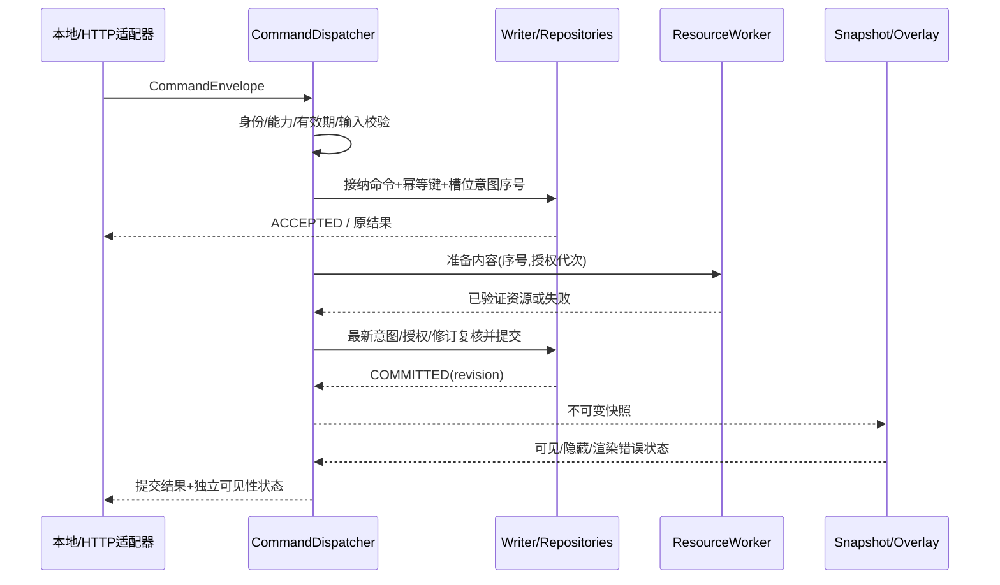

# 调用链与线程模型

> 实施状态（2026-10-30）：用户已授权开始开发。本文保留 D11 设计基线；“仅计划、不开发/不测试/不同步”及“全部待实施”为历史状态，当前实现范围、证据与未完成门槛以[实施进度与验证记录](10-实施进度与验证记录.md)为准。

基线 D11。本文方法名是未来实现建议；不得将伪调用链当作已有代码。功能背景见[功能链](02-功能链与状态机.md)，契约见[接口定义](01-模块划分与接口契约.md)。多科目细则见[实施手册](模块/07-多科目联动与临时课堂.md)。

## 1. 执行域与所有权

| 执行域 | 执行内容 | 不允许 |
| --- | --- | --- |
| UI | 消息循环、窗口创建/销毁、WinEvent接收、预览和绘制 | 网络请求、长哈希、磁盘全量扫描、等待后台join |
| Application/Writer | 串行变更裁决、授权复核、修订比较、短事务、发快照 | 附件复制/解码、无限等待UI |
| Network | Rust端口调用libcurl/Schannel按需HTTPS校历获取 | 回调内改HWND、持有长数据库事务 |
| Worker | 密码派生、图片解码/文件验证、备份等受限任务 | 每请求新开线程或线程直接提交陈旧结果 |
| HTTP（1，启用时） | HTTP.sys OVERLAPPED/IOCP固定槽接收/响应，向应用域投递 | 将每连接绑定独立永久线程、绕过统一用例 |
| TLS SSPI（候选启用时最多1） | 固定四连接的 Schannel 凭据、上下文及同步加解密调用；同线程释放 | 给每连接新开线程、将原生句柄跨线程、占用共享双 Worker；调用未退即替代 |
| Audio（1，按需） | 单播放流、固定缓冲、归还/unprepare及设备关闭 | 阻塞UI/Writer、未归还即Drop |
| Shell STA（1，按需） | 本地主动固定版本文件关联open | 任意远程启动、等待PPT退出 |
| Final coordinator（关闭/独立修复时最多1） | 接管原共享worker/音频的实际关闭、候选生成及冷切换；独立修复进程的清除协调 | 将逻辑完成当物理退出、在UI等待join、并行创建替代协调器 |
| Teacher browser | React视图、草稿、预览、上传和状态查询 | 获得本机数据库权限或直接判定业务已提交 |

Application/Writer 是逻辑串行执行器，可由一个后台线程承担，不为每模块各设线程。开始实现时将线程上限记入构建/性能证据；队列用数量与字节限制，并预留前台隐藏、停止和授权失效等控制消息的处理能力。

第二十六轮 TLS 候选明确新增一个按需 SSPI 执行域，显式申请 1MiB 栈；接纳和 IOCP 仍归调用方单一网络域，不额外创建每连接线程。该候选和旧 HTTP.sys 尚未在正常启动中启用，不能把诊断主线程的复用当生产线程总量验收。停止先撤接纳和关闭 socket，SSPI 调用实际返回、原生资源释放成功以及 Windows 线程对象终结后才结算；任何一步失败均闭锁原域并禁止替代。细节见 [P0 候选 ADR](14-P0独立TCP接纳候选ADR.md)。

UI对象使用 Rust 所有权/Drop 和受限Win32/COM适配；后台捕获不可变ID、revision、generation和弱生命周期标记，不跨线程裸持有可销毁窗口。任何后台结果都经过接收方代次检查。

## C01 启动调用链

```text
EntryPoint
  → Bootstrap.ParseArguments
  → InstanceGuard.LockDataDirectory
      [已锁] → ExistingInstance.NotifyOpenRequest → 退出第二实例
      [成功] → Storage.OpenAndValidate
             → Migration.CheckAndApplyWithBackup
             → AuthService.LoadInitializationState
             → RecoveryCoordinator.ReconcileOperations
  → UiHost.CreateHiddenTopLevelWindowAndTray
  → SystemEventRouter.Subscribe
  → SnapshotLoader.LoadLatestCommitted
  → VisibilityPolicy.Evaluate(CurrentSession, CurrentForeground)
  → OverlayController.ApplySnapshotIfAllowed
  → ChannelSupervisor.StartEnabledChannels
```

存储重工作在后台；UI可先提供状态入口，但未获得有效快照不能显示未经验证的内容。恢复可能触发系统变更核对，不能自动重新打开管理员已关闭的网络监听。固定部署Windows账号，数据目录排他文件锁作为跨会话兜底；仅用session-local互斥量不足以避免同一数据目录的两个接收器。

## C02 前台变化至隐藏/恢复

```text
WinEventProc [注册线程/UI]
  → SystemEventRouter.PostForegroundHint [仅投递]
  → ForegroundMonitor.SampleWindowAndOwner
  → VisibilityPolicy.Decide(session, applicationMode, shellState)
  → VisibilityCoordinator.AdvanceGeneration
  → OverlayController.HideAndPauseDrawing [若需隐藏]
  → 或 PostRestoreRequest(generation)
      → 再采样前台/会话 → 比较generation → ShowNoActivate
```

优先处理隐藏；显示请求可合并。Web更新/倒计时只发业务快照，不发激活请求。不要使用 `WINEVENT_SKIPOWNPROCESS` 后忘记跟踪本应用设置窗口：本应用主动开关窗口也必须发状态事件。

注册WinEvent的线程需要消息循环，回调存在重入场景，应避免同步调用触发更多窗口操作，依据[微软 SetWinEventHook 文档](https://learn.microsoft.com/en-us/windows/win32/api/winuser/nf-winuser-setwineventhook)。

## C03 管理员认证、设置与自启动

```text
SettingsView.RequestUnlock
  → AuthService.BeginVerify [读取参数、限速状态]
  → Worker.PasswordKdf.Verify
  → AuthService.CompleteVerify(generation, result)
  → SessionStore.IssueAdminSession
SettingsView.Save(draft, expectedRevision)
  → SettingsUseCase.AuthorizeAndValidate
  → SettingsRepository.CommitIfRevisionMatches
  → SnapshotBus.Publish
```

自启动等系统操作走分支：

```text
SettingsUseCase.RequestSystemChange
  → Authorize → PersistOperation(PREPARED, desired, previousObserved)
  → SystemAdapter.ApplyScopedChange
  → SystemAdapter.ReadBack
  → FinalizeOperation(SUCCEEDED / FAILED / NEEDS_RECONCILE)
  → 返回期望值、实测值、下一步
```

跨系统没有大事务。数据库最终记录失败时，启动从PREPARED记录核对实际系统状态再修复；保留原值和项目所有权，补偿只恢复本应用修改。权限在执行高影响操作前再查，不让失效设置窗口继续提交。

## C04 内容统一提交



图片文件移入受控资源目录并落盘后，才切换数据库引用。数据库事务失败产生孤立文件，由恢复扫描回收。提交后、事件发布前崩溃，启动重载最新已提交修订；快照是可重建派生值，不是唯一记录。

## C05 课表编辑与单双周复制

```text
TimetablePage.StartEdit → ScheduleService.LoadRevision → SemesterDraft
TimeRangeInput.OnDigitsChanged → NormalizeDigits → TimeRangeValidator
TimetableGrid.OnSubjectSelected → SubjectCatalog.ValidateId → TeachingAssignment.ResolveTeacher
  → DraftReducer.UpdateCell(subjectId, teacherId)
DualWeekWizard.Enable → ValidateBase → CloneWeekPair [新ID、深拷贝]
RoleSelector.Assign → ValidateExactlyOddAndEven
Save → AuthService.Authorize → ValidateAllEnabledTables
     → ScheduleRepository.Commit(expectedRevision, completeSemester)
     → ScheduleStateChanged → C06重算
```

改变“双表同步作息”时，用逻辑行键对应目标行；目标不存在或新增冲突则返回错误，不按可见行号盲目写入。保存包含时间、课程和角色，同一修订一次提交。

## C06 校历选择、教学日解析和倒计时

```text
SystemTimeChanged / Resume / SemesterCommitted / CalendarModeCommitted
  → ScheduleCoordinator.TakeCoherentSnapshot(ResolvedScheduleVersion)
  → ClockPort.NowLocal
  → AcademicDayResolver.Resolve(semester, mode, selectedCalendar, today)
      → TermBoundary.Check
      → SelectedMode.ResolveDate [禁止跨模式回退]
      → MakeupSource.ResolveBaseDate [不递归日期映射]
      → TeachingWeekCalculator.SelectRole
  → LessonStateEvaluator.Evaluate(actualToday, effectiveRows, effectiveCells, now)
  → CountdownCalculator.ComputeDeadlineAndRemaining
  → RecessPresentationPolicy.Evaluate(restPurpose, sameSessionCourses, now, enabled)
  → LessonSceneCoordinator.ResolveEffectiveCourseAndProfile [C12]
  → ReminderService.FilterExpiryBeforeSnapshot → AdaptiveLayout.Compose [C13]
  → ScheduleSnapshot.Publish
  → RefreshScheduler.PlanNextBoundaryAndVisibleTick
```

一次计算使用包含实际/源学期、校历模式与映射的同一ResolvedScheduleVersion；期间有新修订则结果带旧代次被丢弃并重算，不得组合“旧单周表+新校历”。时间是墙上时间；等待由单调时钟管理，收到改时通知时重建预约。

普通秒tick只刷新已确定状态的显示，同时核对是否跨边界；边界/唤醒重新运行解析。两张表时间不同则选表之后再算课时，不能先使用统一时间表决定当前行。

M17仅在用户本地点击后使用一个有界STA启动执行域，流式副本复制走Worker；UI不等待系统关联启动，也不为每个文件/老师常驻线程。见C15。

## C07 公共日历拉取

```text
CalendarUpdateScheduler.RequestIfPublicModeEnabled
  → CalendarProvider.FetchConditionalAndBounded
  → CandidateValidator.CheckYearSourcesDates
  → CandidateRepository.SaveNonActiveVersion
  → CalendarSettings.ShowDiff [不改当日活动安排]
Admin.Confirm(candidateRevision, mappings, expectedActiveRevision)
  → AuthService.Authorize → CalendarService.Validate
  → PersistActivePublicVersionAndMappings
  → C06
```

学校模式不发起影响执行安排的公共更新；用户主动查看候选源也只更新候选缓存。下载任务启动后模式已切换，结果仍只能进候选区，不能改变已选模式或学校数据。

## C09 局域网请求与React页面

```text
TeacherBrowser → HTTPS Request → HttpHost.IOCP（固定IoSlot）
  → RequestLimits → HealthGate → Host/Origin/CSRF → SessionMiddleware
  → ApiRouter → TypedPayloadValidator → 应用用例
  → Writer接纳 → 202 + commandId
React.ApiClient.QueryResult(commandId)
  → 仅查询本人/授权设备的结果
  → 返回业务状态和displayState → PublishPage呈现
```

静态页面无需写权限但不含业务密钥；配对、上传、提交各自校验。先上传得到短期、教师/设备绑定的 uploadId，提交时再校验所有权、是否已消费及修订。教师撤销后上传完成也不能提交。

前端只有限次数退避查询，终止/离页取消轮询；设备离线显示未确认，不生成新命令ID自动重复发布。初期同源相对路径，浏览器页面只访问同源的白板后端。

## C10 停止与取消

停止生命周期：`RUNNING → STOP_ACCEPTING → CANCEL_PREPARATION → DRAIN_SHORT_COMMITS → RELEASE_RESOURCES → STOPPED`。

1. 宿主先标记generation和停止状态，网络入口停止接纳新变更。
2. 取消资源准备、失效上传/配对窗口，已提交命令保持结果。
3. 让短事务完成或回滚；所有等待设超时，已提交结果持久保留，Web重连按原commandId查询，不重放业务。
4. 后台不再投递窗口后销毁窗口/绘图/WinEvent/托盘，最后释放存储与目录锁。
5. HTTP按QUIESCING/CANCELING/DRAINING/CLOSED完成排空；Audio按归还/unprepare/close完成释放，超时不早释放原生仍持有资源，详见共同FFI契约。
6. 即使进程被系统直接结束，恢复逻辑依赖持久状态，不能依赖析构一定执行。

## C11 账号、基础科目与授权配置

```text
FirstRunView.CreatePrimaryAdmin → AuthService.VerifyUninitialized
  → Worker.Kdf → Writer.CommitPrimaryAdminOnce → ClosePublicRegistration
AdminView.SaveSubjectsOrAssignments → AuthService.Authorize(primaryAdmin)
  → M15.ValidateIdsReferencesAndLastAdmin → Writer.CompareAndCommit
  → AuthGeneration.AdvanceAffectedUsers → InvalidatePendingJobs → C12重算
LocalTeacherLogin / WebAccountBinding
  → AuthService.ResolvePrincipal → GrantRepository.LoadScopedCapabilities
```

ProgramData路径/ACL由部署端口先建立并读回，运行宿主取得同一根的排他锁；不是由网络teacherId选择目录。账号/科目变更与授权代次在同一串行域裁决。

## C12 自动课堂及当前节覆盖

```text
C06有效课时 / SubjectProfileCommitted / OverrideCommitted
  → M16.TakeCoherentInputs(ResolvedScheduleVersion,科目,任教,profile,override,配色及底色设置修订)
  → COURSE: ValidateCurrentOverride → EffectiveSubjectAndTeacher
  → BREAK: PublicVisual + LastLessonMaterialContext
  → OtherNonCourse: PublicSceneWithoutTeacherFolder
  → Profile仅COURSE读取；BREAK只读取保留老师资料目录，其他状态无个人目录
  → SubjectProfileRepository.ReadCommittedOrNeutralPlaceholder
  → MaterialListRepository.ReadBoundedPage(folderId, folderRevision, addedSequence DESC)
  → SubjectVisualComposer.Resolve(有效科目,学校配色低饱和派生,底色开关,独立当前课状态,填色时禁用描边)
  → VerifyGenerationsAndScope → SceneSnapshot.PublishAtomically
  → M01.VisibilityPolicy → ApplyNoActivateOrKeepHidden
顶部临时换课提交 → Writer.RecheckNowAndLessonInstanceKey
  → AuthorizeClassAndCompareOverrideRevision → PersistActiveOrReject
  → C12；课时结束/改表/停用 → PersistTerminalOverride → C12公共/下一课
```

UI不等待资料解码，Worker不直接选择/激活窗口。临时覆盖校验、到期、授权撤销与提交串行排序；只覆盖subject/teacher不改变时间范围。旧场景结果即使资源有效也因代次不符丢弃。

## C13 Web日提醒、日终任务与自适应快照

```text
Web.FixedBottomReminderButton → ReminderPage.LoadToday
  → HTTPS SessionMiddleware → ActiveTeacherOrGlobal + SameInstallationSchoolAuthorization → ReminderReadModel
Web.Send/Clear → TrustedOriginGate(lan only) → ValidateDayAndExpectedRevision
  → Writer.RecheckLocalDate → CommitReminder(text, expiresAt=次日零点)
Midnight/Startup/Resume/ClockChanged/Read → ExpiryEvaluator
  → HideExpiredInReadModelImmediately → Writer.ExpireAndPurgeActiveBody
ReminderChanged/AnyWidgetVisibilityOrContentChanged/DisplayChanged/SubjectVisualSettingsChanged
  → AdaptiveLayout.MeasureConstraints → ComposeAllVisibleWidgets
  → OneSceneSnapshot → VisibilityPolicy → 局部刷新
```

旧版网页草稿在新日提交返回REMINDER_DAY_CHANGED。到期写失败不阻止读模型隐藏，恢复后再清理正文；恢复备份也经过该过滤器。跨日工作复用共享调度器，静态磁贴不新增逐秒磁吸任务，Web底部按钮预留内容空间且离页释放订阅。

## C14 三级角色、老师目录与倒序索引

```text
LocalGlobalAdmin.SaveRoleOrTeachingAssignment → M03.Authorize(GLOBAL_ADMIN)
  → M15.ValidateRoleAndReferences → Writer.CommitWithAuthGeneration
MaterialAdd(local/Web) → M03.CheckTeacherAndFolderScope
  → ResourceWorker.ValidateAndStore → Writer.RecheckScope
  → MaterialRepository.AppendWithCommittedAddedSequence → FolderRevisionChanged
C12当前课/临时课解析 → ResolveExplicitTeacherOrConfirmedDefault
  → FolderResolver.ByTeacherAndSubject → MaterialRepository.ReadPage(addedSequence DESC)
  → SceneSnapshot(teacherId, folderRevision, fileRows, generation) → M01文件行绘制
```

按成功提交新增序号排序，不能拿资源mtime；删除目标用materialId而非当前列表行号。USER即使残留任教关联也无写权限。文件夹索引不走图片解码，不扫描全盘。

## C15 本地打开资料与外部应用避让

```text
MaterialFileListWidget.HitTest → OpenMaterialRequest(id,version,sceneGeneration)
  → M17.OpenMaterialUseCase.AuthorizeLocalOriginAndTrustedOpenContext
  → Worker.PrepareLaunchCopyBounded(version,lease)
  → Application.RecheckCurrentSceneOrOwnerWorkbenchAndMaterialState
  → STA WindowsFileLauncher.Open(固定受控路径, verb=open, 无自定义参数/提权)
  → ActionResult(LAUNCH_REQUESTED / 关联缺失 / 失败 / 已取消)
外部软件获前台 → C02隐藏全部展示/输入窗口
返回桌面 → C06/C12/C14取真实当前课与目录 → 当前布局恢复
```

Shell调用不在UI阻塞等待，不持Writer事务，不等待外部程序退出；调用前复核，系统已接纳后不承诺能取消或回收外部文件访问。记录动作元数据，不把启动当内容COMMITTED；失败/重启/超时不自动重放启动请求。Web下载只在教师设备发生，HTTP无启动白板接口。

颜色设置沿用C03：本地全局鉴权 → M15校验subjectId/RGB → M06比较配色及展示设置修订并联合提交 → SubjectVisualSettingsChanged → C12/C13。预览仅操作草稿，个人profile及Web写请求不能改学校配色；作业标签和课表胶囊一次切换。桌面课表视图移除时间页脚及其布局占位，内部TimeRange仍供C06计算。详见[视觉契约](模块/09-科目配色与简洁模式.md)。

胶囊绘制顺序：同版SubjectVisualSnapshot → ResolveEffectiveRgb → FILLED仅FillCapsule、OUTLINED仅StrokeCapsule → CenterCourseName/CenteredCurrentStatus；填色分支不会再叠加CurrentLessonStroke。删除可见节次列只改变视图测量，不删除lessonRowId/作息序号或改变当前课匹配。沿用C12/C13局部刷新，不增加动画或计时器。

R30沿用现有布局/设置链：加载组件布局与科目填充Alpha → 有权草稿修改/合并预览 → 范围/修订校验后保存 → 同版场景重新测量作业优先/资料窄列 → 按填充与整体Alpha合成 → 更新展示输入区。0%组件不截获输入，编辑器列表仍可恢复；取消还原已保存值，透明度不改课程身份或提醒有效期。详见[视觉手册](模块/09-科目配色与简洁模式.md)第6节。

GlobalComponentCommand → RequireGlobalAdmin → ValidateLayoutTreeAndMaterial → Writer.Commit；TeacherHomework/MaterialCommand → ActiveAssignment + RealOwner → Writer.Commit；WebReminderCommand → ActiveTeacherOrGlobal + SameInstallationSchool + LocalDate/Revision → Writer.Commit。所有接纳/异步提交仍复核授权代次。

同版内容/字体/DPI/可用宽度 → AutoMeasureChildren → BoundParentSize → ScreenFlowAndPagination → GlassSnapshotAndInputRegions → M01按区域应用。玻璃反射/高光缓存不加常驻采样，Aero能力变化才重建材质；填充3%、反射50%、课程底色20%分别传递，父填充不乘后代整体。所有新任务见P1-07/P2-09/P3-10/P4-11/P6-08，方法不是现有源码。

### C06增补：剩余桌面大卡与边界撤卡

C06产生RecessViewState后进入C12/C13，M16先确定公共/课堂场景，再按全局常驻右侧磁贴保护区与剩余工作区约束插入或移除RecessCountdown及间距；Rect、文字、绘制和空命中区同generation发布。默认大数字按剩余区域尽量放大（1080p参考220–300DIP），宽度/小时位数/DPI进入测量键。课间秒tick只更换剩余文本，不触发全卡布局；边界先重算再绘制，旧tick不可在课堂复活卡片。

DesktopVisibilityChanged也请求当前时间重算；PPT前台只维持必要的一次性业务边界，不调用Show/Activate。启动/唤醒在课间可直接ACTIVE，跨上课时刻则INACTIVE。实现沿用现有调度/线程，不新建常驻线程或动画循环。

## C16 Web录音到WinMM播放与停止

```text
VoicePage.PointerDown → CaptureController(permission/heldGeneration)
→ AudioWorklet采集 → 正常PointerUp → OfflineResample/Worker.EncodeCanonicalWav
→ VoiceUploadApi → M11鉴权/流式限额 → M06受控VoiceAsset
→ VoiceBroadcastSubmit → M03校验 → M06任务/命令原子提交 → M18.Queue
→ 按需Audio执行域：HealthGate/新鲜StartPermit → 固定WAVEHDR/PCM → waveOutOpen/Prepare/Write
→ CALLBACK_EVENT唤醒 → 全缓冲自然完成且未取消 → Writer更新遍数
→ 可中断间隔1秒 → 下一遍前重新复核许可，或COMPLETED
→ 全缓冲归还 → Unprepare成功 → 释放缓冲 → waveOutClose成功 → 关事件
Cancel/会话或设备事件 → 串行终止代次 → waveOutReset
→ 收齐归还 → Unprepare成功 → 缓冲释放/close/关事件（失败保留并受控退出）
```

HTTP/UI/Writer不等待声音时长。Web收到COMMITTED只显示已排队，最多1Hz查询本人实际状态；PCM正文不进入UI快照。M18终态/旧回调不能推进下一任务，锁屏/休眠/重启不重播。真实设备完成不证明人耳听到。

C12/C15补充：下课保存最终有效老师的LastLessonMaterialContext（含临时覆盖），BREAK只换公共视觉而保留该文件夹，读取实时资料索引；下一节开始、换班/改表/撤权失效则原子切来源并推进sceneGeneration。课间CURRENT_SCENE点击可打开保留目录，边界准备中的旧打开仍取消。


## Rust线程与异常审查（D11）

UI线程只短暂借用窗口状态；同步Win32调用/模态消息泵前结束借用，回调经try_borrow_mut/延迟命令处理重入，不跨ABI unwind。后台拥有Arc/不可变ID并回传窗口代次，销毁时先取消和断开订阅，join在受控关闭阶段有界执行。SQLite单writer持连接，读取也排队；应用callback只查健康闸门下的内存权威快照，禁止同步writer→writer等待。Rust release的unwind策略、extern回调、提交发布故障、队列饱和/取消按Q25分别验证。具体门槛见[Rust开发计划](07-Rust开发与验证计划.md)。

## C17 HealthGate、权威交换与原生停止

```text
AuthenticatedCommand → CommandBus.try_submit [小owned消息/预算]
→ Writer.Validate(lease/expected_versions) → BuildNextAuthority
→ ControlArbiter.EnterAuthorityUpdating(epoch++) → Commit
   [可证明回滚] → RestoreKnownAuthority / AdvanceHealthEpoch / Healthy
   [成功] → AuthorityPublisher.Swap(next) → Healthy → CoalescedNotify
   [成功后swap失败或结果不明] → HealthGate.Faulted(epoch++)
→ 独立控制事件 → UI隐藏/撤输入，HTTP停接纳，Audio终止代次，Materials/Shell取消未起始
→ HTTP: ShutdownQueue/CancelActive → IOCP Drain → ReleaseSlots/CloseHandles
→ Audio: Reset → Returned → Unprepare成功 → Free/Close → Ack
→ ShutdownCoordinator等待有界Ack（不占UI/Writer）→ 本地诊断/受控退出
```

SensitiveRead/Download/EffectStart均先查同一HealthGate与AuthorityReader；Faulted不能只锁住Writer。C04事务提交遵守此协议，C06/C12带实际/源联合版本，C09网络用固定IoSlot及完成排空，C15本地主动打开比较新鲜StartPermit，C16 WinMM比较缓冲/播放代次。全部资源在原属线程结算一次；取消发出与原生完成分离。

执行域及数量/字节上限、HTTP关闭和音频归还细节由[所有权/FFI册](08-Rust所有权与FFI生命周期.md)定义，不为每模块各建线程。其他调用链不允许绕开F20/C17恢复正常服务。
