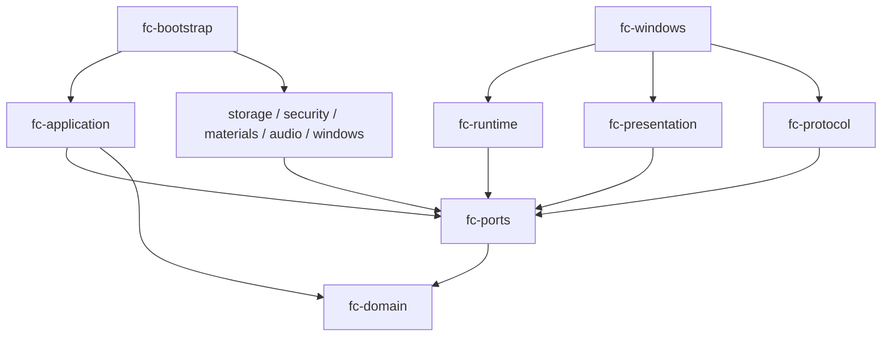

# Rust实施拆解与工程总览

> 实施状态（2026-10-30）：用户已授权开始开发。本文保留 D11 设计基线；“仅计划、不开发/不测试/不同步”及“全部待实施”为历史状态，当前实现范围、证据与未完成门槛以[实施进度与验证记录](10-实施进度与验证记录.md)为准。

总计划1.20 / D11，2026-10-30（北京时间）。本册定义Rust实施边界、crate依赖、接口落点和模块交付。当前只完成计划重拆解，不创建Cargo工程或执行程序。业务需求33项、业务模块18个；重拆后71项主任务、19条功能链、16条调用链、24组验收。任务是工作包，crate是编译边界，二者不按数量一一对应。

[任务与依赖](04-开发阶段与任务步骤.md) · [所有权/FFI/故障协议](08-Rust所有权与FFI生命周期.md) · [构建/目标验证](09-Rust构建验证与发布门槛.md)

## 1. 工程边界

原生端采用Rust 2021 edition候选，Windows平台调用经窄适配层；Win7 SP1 x86低资源目标保留，Windows 10和Windows 11同为首版正式运行目标并分别验收，ARM64系统待明确；详见[兼容矩阵](11-Windows兼容矩阵与验收.md)。教师端仍为TypeScript/React/Vite/Tailwind/shadcn，静态产物随白板程序发布。运行时不引入浏览器内核、Node、转码服务器或独立中心服务。

业务核心与平台无关；unsafe仅允许在经过审查的Win32/COM/WinMM/HTTP.sys和必要C库边界。每个unsafe块说明地址、长度、别名、线程、完成/释放和异常不变量；不以unsafe impl Send/Sync绕过线程归属。API错误使用Result，外部输入不能触发unwrap/panic作为正常校验。

## 2. 十二个生产crate

箭头A→B表示A编译依赖B。公开DTO/值由唯一内层拥有，不在各crate重复定义。

| crate | 编译依赖（自有crate） | 业务模块落点与交付 |
| --- | --- | --- |
| fc-domain | 无 | M03/M07/M08/M09/M15/M16/M18纯规则；TypedId、时间/权限值、课表/场景/声音状态转换；不依赖SQLite/serde/Windows |
| fc-ports | fc-domain | 存储/时钟/随机/文件/音频/文本测量/命令与控制消息端口、非原生句柄的描述对象 |
| fc-runtime | fc-domain、fc-ports | M00/M03协调；HealthGate、AuthorityStore、预算邮箱、取消/代次、观察者合并、M13有界脱敏诊断及退出编排基础 |
| fc-application | fc-domain、fc-ports | M02/M03/M05/M07/M08/M15/M16用例；鉴权/CAS/事务意图、课堂/提醒/文件动作裁决；不导入具体存储/窗口 |
| fc-storage | fc-domain、fc-ports | M06；rusqlite单writer、仓储/迁移/幂等/一致备份；移除原方案中混放在此处的密码学适配 |
| fc-security | fc-domain、fc-ports | M03；RustCrypto PBKDF2/恒定时间比较、秘密生命周期；系统随机/DPAPI经注入端口 |
| fc-materials | fc-domain、fc-ports | M05/M17准备；流式文件/容器校验、资源额度/副本租约；IO/WIC经端口，结果返回PreparedResource |
| fc-audio | fc-domain、fc-ports | M18编排；单队列/总次数/间隔/许可/取消、结果事件；不含WinMM或SQLite |
| fc-presentation | fc-domain、fc-ports | M01/M02/M09；ViewModel、组件/设置页描述、布局树测量/分页；文本测量端口注入，不拥有HWND/COM |
| fc-protocol | fc-domain、fc-ports | M11/M12边界；版本化serde DTO、严格有界解析、命令规范化/错误映射；不自行授权或写数据库 |
| fc-windows | fc-domain、fc-ports、fc-runtime、fc-presentation、fc-protocol | M00/M01/M04/M11/M17/M18适配；Win32/COM/WIC/WinMM/HTTP.sys/Schannel/DPAPI/系统CSPRNG及原生工作台 |
| fc-bootstrap | 上述全部 | M00组合根；构造真实端口/worker与writer，发布一次AuthorityReader/CommandBus，统一启动和停止 |

fc-domain不反向依赖fc-ports；适配器不依赖fc-application。fc-application持有trait object或泛型端口，fc-bootstrap注入具体实现；运行时消息往返不构成反向编译依赖。fc-storage的Connection只由Writer线程构造/使用/销毁，不能经端口传出。M13计数/日志预算位于fc-runtime，Windows资源采样由fc-windows适配；M14由scripts/packaging及bootstrap产物清单承接，无独立常驻进程。M12页面位于web，后端协议仅由fc-protocol拥有。跨平台测试替身放tests/support（非新增生产crate）。



## 3. Rust接口与状态所有权

以下是拟实现签名的语义，不是已存在代码；关联类型/具体命名可按编译结果调整，权限、线性化及资源约束必须保留。

| 接口/对象 | 调用/持有方 | 返回及限制 |
| --- | --- | --- |
| CommandBus::try_submit(OwnedCommand) | UI/HTTP/Worker适配 | Result<CommandTicket, Busy>，有界消息；actor/origin由可信适配器建立，不在UI同步等待Writer |
| StateRepository::commit(intent, expected_versions) | 仅Writer | CommitReceipt含持久修订/结果；不在事务里复制附件/解码/派生口令 |
| AuthorityReader::snapshot() | 各执行域 | Arc<AuthoritySnapshot>和epoch；不续会话闲置，不因Arc存活扩大授权 |
| EffectGate::try_start(lease, intent) | 文件/音频/下载实际执行域 | 新鲜StartPermit，绑定scope/authEpoch/healthEpoch/取消代次；排队时拿到的许可不能替代开始前复核 |
| ResourcePreparePort::prepare(spec, budget, cancel) | Materials执行域 | PreparedResource，仅含受控ID/尺寸/验证结果；应用再复核意图/CAS/授权后提交 |
| AudioOutputPort::submit/stop/poll | Audio执行域 | PlaybackTicket/Completed或Failed；取消接纳与驱动归还分开，线程归属不穿透端口 |
| ClockPort::wall_now/monotonic_now | 领域调用的应用层 | 墙上时间判教学日/倒计时；单调时间管理等待/截止，改时重建预约 |
| UiSnapshotSink::replace_latest | Writer/场景协调 | 只合并最新Arc快照；不把大量通知积成无限队列；实际渲染前复核健康/权限/可见性 |
| PlatformConfigPort::apply/read_back | 本地授权系统执行域 | SystemOperation结果；不暴露任意命令/路径到Web |

TypedId、LocalDate、MinuteRange、Revision、AuthEpoch、SceneGeneration等为独立newtype，禁止跨类型比较。原生HANDLE/指针/Connection不进入Command、Snapshot、serde DTO或领域类型。序列化只在fc-protocol/fc-storage边界，业务整数不用usize持久化；长度转换到DWORD/usize前checked conversion。秘密缓冲不进入普通Clone快照、日志或panic文本。

## 4. 拟定目录与文件职责

```text
crates/fc-domain/src/{ids,time,auth,schedule,calendar,scene,voice,layout}.rs
crates/fc-ports/src/{store,commands,authority,files,clock,audio,ui}.rs
crates/fc-runtime/src/{health,authority,mailbox,cancel,shutdown,metrics,redacted_log}.rs
crates/fc-application/src/{auth,settings,content,schedule,calendar,scene,voice}.rs
crates/fc-storage/src/{writer,repositories,migrations,journal,backup}.rs
crates/fc-security/src/{password,secrets,credentials}.rs
crates/fc-materials/src/{prepare,archive_budget,xml_budget,leases}.rs
crates/fc-audio/src/{queue,coordinator,events}.rs
crates/fc-presentation/src/{viewmodels,widgets,settings,layout}.rs
crates/fc-protocol/src/{dto,parse,canonical,error}.rs
crates/fc-windows/src/{ui,render,wic,shell,winmm,http,crypto,system}/
crates/fc-bootstrap/src/{main,compose,lifecycle}.rs
web/src/features/{pairing,homework,materials,reminders,voice}/
tests/support/              Clock/IO/Audio/Authority故障替身与合成数据
scripts/ packaging/         锁定构建、导入检查、许可清单、ZIP/MSI
```

各crate的lib.rs仅导出稳定边界。Windows特性按模块白名单锁定；WinRT/WebView/默认网络运行时不因方便被整包启用。C库只保留实际需要的SQLite/libcurl等；第三方crate仍检查MSRV、target cfg、build.rs及原生导入。

## 5. 实现顺序与十二项新增任务

| 新任务 | 实施目的 | 对应Review |
| --- | --- | --- |
| P0-09 | 完整Rust/C依赖图的Win7链接/启动探针及锁定元数据 | RR-06及RV-55/RV-56 |
| P1-08 | HealthGate/AuthorityStore及提交发布失败的全局拒绝策略 | RR-01 |
| P1-09 | 有界执行域/控制通道/取消/关闭，不阻塞UI | RR-01/RR-04 |
| P1-10 | typed值、严格serde DTO、规范指纹与版本集合 | RR-03 |
| P2-10 | 独立fc-security与秘密/lease生命周期 | RR-01 |
| P3-12 | 容器/解压/XML硬额度与受限流式验证 | RR-05 |
| P3-13 | 固定地址WinMM资源与归还/unprepare/释放状态机 | RR-02 |
| P4-12 | 实际/来源学期联合修订、缓存与覆盖失效 | RR-03 |
| P4-13 | 最后实际老师的有界历史证据、课间恢复与目录投影 | RR-03及课间资料要求 |
| P6-11 | HTTP.sys重叠IO/IOCP所有权及取消后完成排空 | RR-04 |
| P5-06 | host/Win7构建与许可/包的可复现验证 | RR-06 |
| P5-07 | Rust故障注入/FFI生命周期交叉集成矩阵 | RR-01至RR-05 |

原任务也重定交付：P1-01建workspace/依赖规则；P1-02实现存储；P3-11实现声音业务队列及元数据，P3-13才接WinMM；P4-01建课表值，P4-12/13补版本与历史来源；P6-01集成HTTP.sys宿主但等待P6-11；P6-10完整四页；P5-01等待新任务而非直接沿用旧依赖。完整71项DAG见任务表。

## 6. 完成状态与估算

当前完成的是D11计划/契约/步骤与文档审查，程序任务全部待实施。7项Review问题在文档层分别落实并增加验收映射，运行状态仍NOT_RUN。Rust重拆估算81–133人日，P0后校准，外部等待/72小时观察等待另计；不能使用旧63–104人日作为Rust交付承诺。

原始UI与产品功能保持；P0真机门槛未过不声称兼容，ARM64系统未明不伪造支持。GitHub按用户安排保持现状，本轮只维护本地计划。
