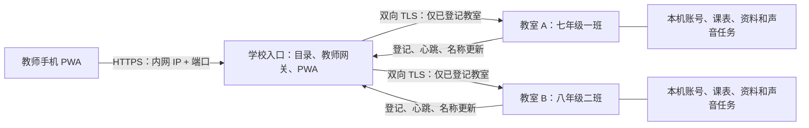

# D13：纯内网 PWA、教室自动发现与学校证书

日期：2026-11-05。状态：已开始开发，直连快捷连接/PWA与学校证书基础已有首批代码，完整D13尚未交付；实际证据见第13节及实施记录。用户已认可“手机统一入口、自动列出教室、按配置班级名称选择”的方向，并明确实际学校没有域名、不使用当前开发 NAS。本方案是总计划 1.48 的新增范围；既有桌面、Web 管理及数据规则未调整部分沿用 D12。计划修订完成后，用户已明确要求开始开发；按实际实现、构建和运行证据记录，不把文档完成记为功能交付。

## 1. 确定的部署方案

学校选一台常开的教务电脑或校内服务器运行“学校入口”，不要求 NAS、域名或公网。教师手机只访问这个入口，各教室仍安装现有原生程序并独立保存课表、账号、作业、资料和录音任务。

- 示例入口：`https://10.20.0.10:9443/pwa/`。这是文档示例，不是已经分配的学校地址。
- 学校入口 IP 使用固定地址或 DHCP 保留，端口在安装时检查；最终地址制作成学校入口二维码。
- 每所学校独立生成根 CA。手机首次信任一次学校根证书，之后入口和所有教室的证书由程序签发、更新，不逐间安装。
- 教室程序启动后自动向入口登记，班级名称取其配置中**当前绑定的班级名称**；保存班级或更名后自动更新目录。
- 手机读取教室目录，不在浏览器逐个扫描 IP，不依赖 UDP/mDNS、浏览器实验开关、外网发现服务或云中转。
- 教室 IP 可以改变，设备身份不随地址或班级名称改变；学校入口 IP 应保持固定。

首批交付覆盖发现、选班和现有教师作业、资料、提醒、录音功能，不同时建设全校统一课表数据库、统一教师账号或跨班自动广播。学校入口没有教师业务写入的超级账号；教室仍逐项校验教师会话与任教范围。

## 2. 教师与管理员实际操作

### 2.1 学校管理员首次部署

1. 在常开电脑安装独立的“学校入口”，设置学校名称和入口管理员用户名、密码，固定入口 IP/端口。
2. 安装器准备学校证书、签发服务和受限数据目录，生成学校入口二维码、公开根证书、iPhone 描述文件及信任说明。学校 CA 私钥不放在这些文件中。
3. 给各教室配置一次学校入口及设备登记许可。可以通过本机 Web 或学校安装配置导入，不让老师逐节课配对。
4. 程序自动取得本设备证书、完成双向连通核对，然后出现在目录中。没有绑定班级的电脑列为“待绑定”，不冒充任意班级。
5. 管理员统一分发学校证书安装包，或在有设备管理系统时集中下发信任；普通手机按说明完成一次系统信任。

### 2.2 老师第一次使用

在教室电脑任务栏通知区域右键“未来教室”图标，选择“快捷连接”，即可看到二维码和完整网址，不必找管理员索取或手动抄写地址。通知区域图标可能位于Windows的折叠区，此处不是修改Windows任务栏系统菜单。

1. 连接学校 Wi-Fi，取得学校根证书并按手机系统完成信任；已有集中下发信任的手机跳过此步。
2. 扫入口二维码，打开可信 HTTPS 页面；可以先使用网页，也可选择“安装到手机/添加到主屏幕”。安装须由用户确认，不能静默安装。
3. 看到按年级/班级整理的列表，搜索或选择自己的班级。
4. 用该教室已有用户名、密码登录，然后使用现有教师功能。安装 PWA 不获得账号或授课权限。

### 2.3 后续使用

- 从手机桌面打开同一个 PWA，即可看到最近使用、收藏及全部可用班级；教师不需要记各教室 IP。
- 点击班级后在同一个 PWA 内加载功能，始终显示当前学校、班级与连接状态。
- 手机收藏只保留学校/设备标识与显示信息，不保存密码、访问令牌、作业或录音文件。
- 已打开页面内刷新、普通闲置、前后台切换和短暂断线不重复索要密码；切回本次页面已登录的教室可以恢复该教室会话。
- 各教室当前账号互相独立。首次进入另一教室可能需要登录该教室；同名账号不自动当作同一身份。本期不伪装成统一登录。
- “关闭后重新登录”沿用标准标签页/sessionStorage 语义；PWA 被系统挂起不等同主动退出，不增加识别所有系统杀进程/恢复行为的硬门槛。

### 2.4 托盘“快捷连接”与扫码引导

**教室电脑上的入口：**

- 右键产品托盘图标，新增独立菜单项“快捷连接”，与“查看状态”“设置”“退出程序”并列；查看公开连接信息不要求输入管理员账号密码，不改变教师登录权限。
- 点击后直接打开本机Web的专用快捷连接页，例如 `#/connect`，延续D12全部页面使用Web的架构，不重新引入原生设置窗口；不要求先登录管理后台，也不自动开启外部监听。
- 页面突出显示学校名称、当前绑定班级、可扫描二维码、完整的 `https://IP:端口/路径`，提供“复制地址”和“打开网站”。连接信息允许无管理会话读取，只包含最小公开展示数据，不附带管理员配置详情。
- 二维码优先指向已配置且已核对的学校PWA统一入口，可携带当前设备ID作为选班提示。目标班级仍从可信目录解析并展示，不凭二维码参数自动登录、授权或执行写入。页面明确标注“学校统一入口”或“本教室直连”。
- 未配置学校入口时，可显示已经启用且配置有效的教室HTTPS直连地址；直连也提供PWA引导，安装后明确仅连接本教室，不假装拥有全校目录。若学校入口已配置但暂不可达，保留入口并显示检测状态，教室直连作为明确可选项，不悄悄切换手机安装的origin。
- 不编码本机管理用的 `127.0.0.1`、`localhost`、通配监听地址或仅本机维护端口。根据显式发布地址、IP SAN和配置选取手机可达地址；有多个校内地址时显示明确候选，由本机管理员选择发布地址，不猜测VPN/虚拟网卡地址。
- HTTPS未启用、证书过期/地址不符或学校地址未准备好时，显示具体原因及“请管理员完成连接设置”，不生成标记为可用的二维码。显示“配置有效/最近可达”不等于手机实际可达；提示手机连接学校网络及可能的Wi-Fi隔离。
- 地址/端口或班级绑定更新后同步刷新；过期读取不得覆盖新地址。提供刷新按钮，复制失败时保留可选中的明文地址。二维码在本机用随包编码库生成，无外部二维码服务、无网络图片请求，保证静区、清晰对比和长地址实际可扫描；二维码不是imagegen绘制资产，产品图标继续使用既有imagegen资产。
- 二维码仅包含公开HTTPS入口与可选班级提示，不包含密码、会话令牌、设备登记许可、证书私钥或免登录票据。扫码仅打开网站，仍按原用户名密码和页面会话规则使用。

**手机上的PWA提示：**

- 扫码和手动打开同一个网站进入相同引导，不依赖扫码来源参数。首次在普通手机浏览器打开时，展示“添加到手机桌面，下次直接打开”的非阻断提示，提供“安装/查看添加方法”和“稍后”，不遮挡登录或强制安装。
- 支持浏览器安装事件时，仅在老师点击按钮后触发系统安装提示；未收到安装事件时显示真实的手动步骤，不显示不能执行的“一键安装”。iPhone展示“分享 → 添加到主屏幕”说明，内置浏览器提示用Safari/受支持系统浏览器打开。
- 已在独立PWA窗口运行时不重复显示安装提示；本次选择“稍后”后不因切班、刷新或登录再次弹出，之后保留帮助入口。拒绝安装不会自动重复调用系统弹窗。
- 首次根证书信任仍先于可信HTTPS网页/PWA。快捷连接页在电脑上同步显示“首次使用先完成学校证书信任”及公开材料获取方法；若管理员已开启第3.3节的独立证书引导口，可提供清楚标注的第二个“首次证书安装”二维码。两码不得混淆，不宣称HTTPS证书警告页能运行网页引导，也不指导老师忽略警告继续登录。

## 3. 无域名证书的完整处理

### 3.1 必须明确的边界

公信 CA 不能为 `10.x.x.x`、`192.168.x.x` 等保留私有 IP 签发普通公网信任证书。PWA、Service Worker 和直接录音需要可信安全上下文。无域名、无公网条件下，采用**学校私有 CA + 手机一次性系统信任**，不能用安装包共享私钥或“忽略证书错误”替代。

网页不能静默把学校 CA 加入普通手机的信任库。iPhone 手动安装证书描述文件后，还可能需要在“证书信任设置”启用完整信任；这一步由学校管理员或老师在系统界面完成。程序负责生成材料、明确指导、检测结果及后续自动签发续期，不承诺绕过操作系统确认。

### 3.2 证书层次和所有权

| 对象 | 生成和保存位置 | 用途及生命周期 |
| --- | --- | --- |
| 学校根 CA | 首次安装生成；私钥形成独立加密恢复包，完成验证后不留在在线签发进程 | 每校不同，建议 10 年；公开根证书供手机信任，根私钥仅管理员离线恢复使用 |
| 学校签发中间 CA | 学校入口专属受保护密钥存储；私钥不进配置模板/普通备份 | 建议 3 年，签发本校叶证书；到期前由入口管理员使用根恢复材料续签，教师无需重新信任同一根 |
| 学校入口服务端证书 | 入口本机生成私钥，提交 CSR | IP SAN 包含实际入口 IP，Server Authentication；建议 90 天，剩余 30 天自动续签 |
| 教室服务端证书 | 教室 CNG 中生成不可导出私钥，签发端只接收 CSR | IP SAN 包含已核对的本机地址；Server Authentication；不把私钥传给入口 |
| 入口中转客户端证书 | 学校入口生成，私钥仅入口持有 | Client Authentication；Windows 中转监听校验精确学校/网关身份，不接受任意本校叶证书代替网关 |
| 教室登记客户端证书 | 教室生成并经设备登记签发 | Client Authentication；设备心跳和更名报告身份；不具有教师业务权限 |

初版使用兼容现有 Win7 TLS1.2/Schannel 目标的 RSA/SHA-256 证书配置；具体密钥长度、EKU、BasicConstraints、链和 CSR 属性在 P13-01 固化为测试向量。根/中间 CA 证书明确 CA 约束；叶证书不能签发下级证书。教师手机不需要客户端证书。

Windows 入口作为独立服务运行，私钥 ACL 只授予其服务身份及必要管理员；采用 Windows 密钥存储/DPAPI 保护。Linux 入口使用专属用户、受限文件及部署秘密存储。代码仓库、日志、PWA 缓存和分发包均无私钥、恢复密码或设备登记秘密。

### 3.3 首次信任如何交付

- 安装器输出公开 `学校名称-根证书.cer`、iOS `.mobileconfig`、SHA-256 指纹及图文步骤；指纹同时显示在学校入口电脑上，可线下核对。
- 优先通过学校管理员、已有受信任的文件分发渠道或设备管理系统提供。二维码只提供入口、学校标识和指纹/说明，不能声称扫二维码就自动获得系统根信任。
- 可信 HTTPS 页面本身不能作为唯一的首次证书来源，避免“未信任所以打不开下载页”的循环。
- 可选提供**单独、默认关闭的证书引导 HTTP 端口**，仅在管理员开启部署模式时下载上述公开材料和静态说明；不提供登录、班级目录、任何业务 API，不接收密码/录音，不跳过线下指纹核对。部署完成可关闭。此端口是证书引导，不是业务 HTTP 降级，TLS 故障时不能自动开启。
- 兼容性目标先覆盖 Android Chrome 和 iPhone Safari/已安装 PWA；内置聊天浏览器提示用受支持系统浏览器打开。实际设备信任、安装和录音分别验证，不用桌面浏览器结果替代。

### 3.4 续期、地址变化和故障

- 签发完全在校内完成，不需要 DNS API、ACME、公网 CA 或互联网连接；软件更新与证书续期无耦合。
- 叶证书按实际有效期调度，正常离线/重启后恢复续期，不在每次启动重复发新证书；失败退避，旧证书有效时继续使用并显示维护提示。
- 采用“生成新密钥/CSR → 校验链、用途、IP、私钥归属 → 保存候选 → 切换 → 握手回读”。失败保留旧有效证书；过期或不可信时停止新连接，不自动改用 HTTP。
- 教室 IP 变化时，经已有设备身份和校内地址白名单核对后补发含新 IP SAN 的证书，再更新目录；名称、IP、证书都不替代稳定设备 ID。
- 学校入口 IP 变化属于入口迁移：要更新证书、二维码和手机入口，原 PWA 的 origin 不会因改签证书自动迁移。因此优先使用 DHCP 保留；计划不假定 IP 随意变化而手机毫无感知。
- 根 CA 恢复包、在线签发状态、设备目录和入口地址共同进入独立加密恢复流程。保留原根恢复可沿用手机信任；根丢失/撤换则必须重新部署手机信任，不能宣称自动解决。
- 设备撤销后，入口立即停止其目录可用状态和中转准入；设备维护与中转校验同时检查本校登记状态、安装代次及允许证书身份，不能只因证书链仍有效而继续接受已撤销设备。网关身份更换通过教室已有认证配置更新；无法联系的教室明确标记待更新，不承诺远程撤销能立即影响离线设备。
- 入口提供“根证书状态、证书到期、最近续签、链验证、地址匹配、设备证书状态”诊断。检测明显错误系统时间并给出校时指引，不自动修改学校电脑时间或关闭证书日期检查。

## 4. 教室目录和自动发现

### 4.1 身份、名称和年级

- 目录主键为 `(schoolId, deviceId)`，均为独立稳定不透明标识；本地 `classId` 仅在该教室安装内有意义。
- 展示名称来自已认证教室提交的当前绑定班级和 `identityRevision`，不由 IP、Windows 电脑名或心跳里的任意展示字符串猜测。
- 年级是可选目录分组元数据：管理员可设置“七年级/八年级”，不按班级名称里的数字自动推断。没有年级也可按班级搜索。
- 同名班级、两台设备绑定同一班级时显示教室位置/设备后缀，不自动合并；更名不清空收藏或创建新身份。
- 更换/重装设备需要明确重新绑定或迁移目录身份，不能仅凭同一 IP 或同一名称继承旧设备密钥。

### 4.2 登记流程

1. 入口管理员生成单次、短有效期的设备登记许可，绑定本校及允许网段；教室管理员从本机 Web 导入或在部署时安装配置。
2. 教室核对管理员提供的学校根指纹，在自身密钥存储生成密钥和 CSR，通过校验过的入口 HTTPS 登记。
3. 入口验证登记许可和 CSR，绑定稳定设备 ID，签发设备证书；使用后的许可不能重复登记另一设备。
4. 教室报告绑定班级、修订、版本、地址和中转端口。入口从自身真实连接验证目标身份及 TLS，不仅凭“登记成功”就显示可用。
5. 起始登记立即执行，心跳默认 30 秒，连续约 120 秒未收到更新记为离线；到期判断使用入口单调时间。更名/绑定变化合并后立即报告。

登记许可只在部署时由管理员使用，不引入教师登录的配对码、设备审批或额外验证。

### 4.3 状态与扫描补充

列表区分“可用、仅登记/正在连接、离线、证书异常、未绑定、版本不兼容”；“可用”须有入口到教室的成功验证，真实业务仍可能遇到当时繁忙或权限不足。

“刷新/查找教室”默认刷新登记目录及有界连通核对。对于尚未登记的新版程序，可在入口管理端提供受限网段查找：管理员选择明确校内 CIDR 和已配置产品端口，默认并发 8、单次连接约 1 秒、一次最多 256 地址；不能扫公网、所有端口或不断重试。探测所得仅列为待登记线索，不能因对方回传一个班级名称就对老师开放连接。旧版没有发现能力时，需升级或手工登记，不宣称扫描能识别所有第三方/旧程序。

## 5. 一个 PWA 内切换教室的接入契约

### 5.1 固定同源入口

- PWA 静态资源、目录和教师网关均位于同一个 `https://入口IP:端口/pwa/` origin/scope。
- 示例路径：目录 `/pwa/api/v1/rooms`；某教室 API `/pwa/rooms/{deviceId}/api/v1/...`。手机不直连各教室，因此不需要逐设备跨域许可或逐设备根信任。
- 入口把已登记 ID 映射到已验证校内地址和端口。请求不得携带任意 upstream URL；不跟随目标重定向到其他主机，不代理回环、入口管理口、云元数据地址或非登记设备，防止变成任意内网代理。
- 学校网络须允许手机到入口、入口到教室中转端口、教室到入口登记端口。不同 VLAN 可以通过明确路由/ACL 接入；不能承诺加入同名 Wi-Fi 就必定互通。

### 5.2 保留现有教室鉴权

现有 `WebBoundary` 固定校验 Host、Origin、Sec-Fetch-Site、页面凭据和 CSRF；会话 Cookie 当前 `Path=/`，Web 客户端还有模块级 `activePageToken`。因此不能只加普通反向代理或把所有教室原 Cookie 原样透传。

具体调整：

1. 新增显式受信任中转接入作用域。入口到教室使用独立中转监听，默认建议 8444；必须通过双向 TLS 的精确学校网关证书校验，再接受固定版本中转上下文。普通教师 8443 和本机回环管理不受此隐式授权。
2. 中转上下文由入口构造，绑定学校、设备、目标安装代次、真实外部 origin、规范路由及请求标识；入口先丢弃浏览器自行提供的同名代理头。Windows 不因普通 `X-Forwarded-*` 或来源 IP 获得中转权限。
3. 入口严格检查外部 Host/Origin/Fetch 元数据；教室识别“经过认证的网关上下文”，仍执行其原页面会话、CSRF、角色、任教范围、修订和命令检查。不能通过伪造本机 Origin 或统一改成127.0.0.1绕过原边界。
4. 每教室会话 Cookie 在入口侧使用独立名称与 `/pwa/rooms/{deviceId}/` 路径，保持 Secure、HttpOnly、SameSite；进入教室前只转换该教室的 Cookie，不向上游转发其他教室或入口管理员 Cookie。
5. 页面临时凭据按学校/设备分区；API 客户端实例拥有不可混淆的目标和页面凭据，改掉当前全模块活动令牌对多目标请求的假设。
6. 选择别的班级时取消旧页面读取，并用目标代次隔离迟到结果；不能把“浏览器取消”当成教室已取消写入。已提交操作必须在原教室查询原结果，不把超时写入自动重放到新班级。

网关只有传输身份，没有代替教师的超级会话。凭据只在 TLS 连接处理的必要内存中使用，不记录密码、令牌或正文；不在入口数据库复制教师密码派生值。当前阶段每教室仍拥有自己的账号。

### 5.3 教师功能与写入

- 复用现有教师作业、资料、提醒、规范 WAV 录音与声音任务接口。入口不新增音频转码或独立播放任务系统。
- 上传、分块、下载采用有界流和原端点限制，继续保留原 SHA、命令 ID、CAS 和结果查询，不整份录音/资料无界读进内存。
- 录音从当前已选班级开始，录音、上传及任务查询绑定同一个设备/安装代次；发送前显示目标班级。切班时停止本机采集并明确保留/放弃当前录音，不能悄悄发到另一个班。
- NAS 无关：任何合格学校入口电脑均可中转，公网断开不影响校内证书、目录和业务。
- 本期中转教师端点白名单，不开放安装、修复、重置、任意文件路径、远程 Shell 或 Windows 启动接口。原本机 Web 管理完整保留。

## 6. PWA 安装、缓存和页面状态

- Manifest 使用稳定学校应用 ID、入口 IP/端口、`start_url=/pwa/`、`scope=/pwa/` 和独立窗口模式；使用项目现有 imagegen 品牌资产导出合格 PWA 图标，不引入另一套默认图标。
- Android 支持时显示用户触发的安装按钮；iPhone 提供实际添加到主屏幕步骤。未安装也可使用同一网页，不强迫安装才能登录。
- Service Worker 只缓存已校验版本的应用壳、静态图标和离线说明；API、登录、Cookie、作业、资料和录音一律不进通用持久缓存。
- 收藏和最近班级可本地保存最小显示信息，明确“最近看到，离线状态未知”，不把缓存的在线状态当作现场在线。
- 离线可打开壳和最近班级名称，不允许离线提交作业或排队发送语音；恢复网络后先重新核对学校和设备身份，不自动重放写入。
- PWA 更新在无待确认写入、录音、上传时应用；有未保存草稿时提示更新，不自动刷新丢弃。协议不兼容时保持可读错误，不以旧缓存脚本调用新端点后显示假成功。
- 退出账号清除当前页面权限和对应临时凭据；移除学校可清理该校收藏。卸载 PWA 不能被当作可靠服务端退出事件。

## 7. 架构、进程和数据所有权

### 7.1 仍保持十二 crate

不增加第十三个 Windows 业务 crate，不把 Linux/网关依赖注入原生桌面默认构建。在现有 `fc-bootstrap` 中增加独立二进制 `fc-school-gateway`，使用明确 gateway feature/目标依赖组装；Windows 教室默认构建不启用该 feature。入口可独立运行于 Windows 10/11 x64；Linux/容器是可选分发，不以 Docker/NAS 为前置。教室 Win7 SP1 x86、Win10、Win11 兼容设计和构建检查继续，实机范围仍遵用户决定。

| 所有权 | 落点 | 负责内容 |
| --- | --- | --- |
| 纯设备身份和目录规则 | fc-domain | 学校/设备标识、绑定版本、登记状态及能力，不含 socket/证书句柄 |
| 平台端口 | fc-ports | 目录持久化、设备登记传输、证书签发/存储、可信中转上下文 |
| 登记和签发用例 | fc-application | 登记许可、绑定、更名、证书更新及撤销规则；不实现 TLS/系统密钥存储 |
| 严格线协议 | fc-protocol | 版本化登记/目录/relay DTO、大小限制、规范路由及错误 |
| 各自存储 | fc-storage | 入口目录/证书索引独立 schema 和单 writer；教室沿原数据库保存本机配置，绝不共用同一 SQLite 文件 |
| 密钥与认证 | fc-security + 系统适配器 | 密钥材料生命周期及验证；实际证书/私钥句柄不进入领域 |
| 有界运行域 | fc-runtime | 入口独立预算与取消；教室沿用原双业务 worker/IOCP/单 SSPI 域 |
| Windows 适配 | fc-windows | 服务宿主、CNG/Schannel、CSR、证书导入/校验、登记网络 I/O，桌面渲染不负责发现 |
| 组合根 | fc-bootstrap | 教室可选登记协调器，以及独立学校入口进程、配置、关闭和平台注入 |
| PWA | web/src | 稳定入口、安装引导、班级选择、分区客户端和既有教师页面 |

Windows 入口安装包使用独立 ProductCode/UpgradeCode、服务名、数据目录、端口与卸载归属，不手工改写原教室 MSI 所属文件。入口服务不得启动桌面/音频。原生托盘管理入口、桌面下层及画布不因增加学校入口而重构。

### 7.2 目录持久化边界

入口数据库只存学校显示信息、设备稳定标识/绑定、班级与可选年级元数据、允许地址、证书公钥/序列号、设备状态、必要登记和管理操作记录。设备凭据/签发密钥使用独立保护存储。心跳活跃状态及中转过程不复制课表和原件；重启后未重新验证的设备显示“待连接”，不沿用旧在线状态。

普通教师不能通过列表获得账号、学生姓名、课表详情、证书私钥或设备秘密。班级目录是否未登录可见由学校入口策略控制；默认限学校网络仅展示最小班级信息，实际内容仍须教室鉴权。

### 7.3 有界资源初值

- 入口默认最多 256 个设备记录、128 个并发教师页面；目录前台最多每 15 秒刷新一次，可用修订号避免重复全量结果。
- 网关最多 32 个上游活动请求，单教室最多 2 个，等待队列每教室最多 8；真实值须与原生端可用槽协调，不能增加入口并发把教室挤死。
- 教室侧总业务连接槽仍按原 4 槽，保留本机控制面容量；新增 relay listener 有独立、有界接纳内存，复用原网络执行域和可复用的局域网证书凭据，不增加每连接线程。若原槽不能满足分配，先调整共享准入，不擅自倍增原预算。
- 心跳/登记复用既有后台任务域，带超时、取消和退避，失败不阻塞桌面绘制、声音停止或本机管理；单次登记/心跳文档初值上限 16 KiB。
- 中转正文/分块限制以既有端点为上限，有界缓存/流式转发，不能自行提高资料、录音或并发预算。入口资源预算独立于教室16 MiB图形/原生网络预算，分别报告。
- 上述为设计初值，不是已通过的容量或性能结论；只在实际输入需要时校准，不开展额外压测工程。

## 8. API 和配置清单

所有新接口带 `schemaVersion`，设备 ID 为固定不透明标识，修订为原十进制字符串；未知字段和非法路径按既有严格 DTO 策略处理。

| 位置 | 接口/配置族 | 权限和关键结果 |
| --- | --- | --- |
| 入口本机初始化 | school/setup、CA 初始化、公开信任包 | 仅本机未初始化，明确准备/提交/回读；不允许局域网抢占学校管理员 |
| 入口管理 | 登录、登记许可、设备绑定/撤销、证书状态 | 用户名密码；修改有修订、影响说明和实际结果 |
| 设备登记 | enroll/challenge、enroll/complete | 单次许可、CSR、根指纹和目标地址核对；结果是设备身份，不是教师会话 |
| 设备维护 | heartbeat、binding、certificate/renew | 已登记客户端证书、学校/安装代次；幂等更新，不按重试创建新身份 |
| 手机目录 | `/pwa/api/v1/rooms` | 最小班级信息、目录修订和连接状态；不返回上游秘密 |
| 本机快捷连接 | 本机Web只读连接信息与 `#/connect` 页面 | 无需管理登录；仅学校/班级、发布地址、入口类型、准备状态及公开信任指引，不返回凭据；不自动启监听 |
| 教师中转 | `/pwa/rooms/{deviceId}/api/v1/...` | 固定教师白名单、分区 Cookie/页面凭据、mTLS 及原教室鉴权 |
| 教室配置 | schoolEndpoint、schoolId、根指纹、deviceId、relayEnabled、relayPort | 本机全局管理员可管理；普通老师不可改学校或登记设备 |

错误至少区分：入口不可达、学校不匹配、待登记、设备离线、证书不可信/过期/IP不匹配、版本不兼容、教室繁忙、需要该教室登录、权限不足、写入结果待确认。UI 不把所有失败都显示为“密码错误”。

## 9. 实施工作包与依赖

以下是 D13 子任务，不覆盖原 P0–P7 稳定任务编号。每项完成均记录源码、实际检查和未运行范围，不按“写好计划”完成任务。

| 编号 | 前置 | 实现内容 | 交付与完成条件 |
| --- | --- | --- | --- |
| P13-01 | 无 | 入口独立配置/存储和学校证书生命周期；固定 schema/资源/端口 | 生成独立学校 CA、服务端/客户端 CSR和证书、离线根恢复包及公开信任包；无共享私钥/公网依赖 |
| P13-02 | 01 | 教室登记、心跳、绑定名称报告和目录状态 | 已绑定班级自动出现，更名保持设备身份；未登记探测不进入可用列表 |
| P13-03 | 01 | 原生 relay TLS 作用域和固定认证上下文 | 本机/直连/中转作用域分离；拒绝无网关证书、跨学校及伪造代理头 |
| P13-04 | 02、03 | 入口教师中转、Cookie 和客户端目标分区 | 双教室会话不串，原有教师权限与CAS/命令结果保持，不开放维护/任意代理 |
| P13-05 | 02、04 | 手机班级列表、搜索、分组、收藏、最近使用和切班 | 名称来自绑定配置；迟到结果、未确认写入和录音不会跳到其他班 |
| P13-06 | 01、05 | Manifest、Service Worker、安装/信任指引和更新 | Android/iPhone安装路径可用；离线只缓存壳，无敏感缓存及离线重放 |
| P13-07 | 01–06、09 | 学校入口独立 Windows 包、可选 Linux 包、证书/设备部署包 | 普通学校常开电脑可部署，无 NAS/域名/公网；入口/教室各自升级卸载不破坏对方 |
| P13-08 | 07 | 必要集成核对、5分钟观察、文档与回滚说明 | 校内入口＋Win11教室＋实际手机闭环；原数据保留；准确标注模拟与实机证据 |
| P13-09 | 01、02、06 | 托盘快捷连接、本机免管理登录连接页、离线二维码及地址展示、手机安装提示 | 第2.4节闭环；学校入口与直连区分、状态准确、扫码及手动进入均有PWA提示，二维码无秘密 |

推荐顺序为证书/设备目录先行，再完成严格中转，最后接 PWA 安装、P13-09快捷连接和教师体验；P13-07打包与P13-08最终集成同时覆盖P13-09交付，不以它后列的编号将其排除。不能先发布一个看似可安装、实际跨教室登录串用或录音被证书拦住的空壳。

## 10. 验收范围：只做本次必要检查

| 范围 | 最小必要场景 | 通过依据 |
| --- | --- | --- |
| 纯内网与信任 | 断开公网；安装学校根后，以真实内网IP打开入口 | 无浏览器证书警告，安全上下文、PWA和录音权限正常；不使用忽略TLS开关 |
| 学校证书 | 生成/续签及一次故障回退；错误IP/用途/学校链拒绝 | 旧有效配置保留，失败不开放不可信连接，私钥不出所属主机 |
| 自动发现 | 启动登记、改班级名称、IP更新、离线再上线 | 稳定设备ID、正确班级、有限时间内状态更新，不显示假在线 |
| 多教室隔离 | 两个不同设备/安装代次，交错请求和切班 | Cookie、页面凭据、缓存、结果、上传和录音都不串班 |
| 权限 | 普通教师访问教师白名单及越权/维护路径 | 原角色和任教检查保持，中转身份证书不等于教师授权 |
| 页面会话 | 刷新、普通闲置、前后台恢复、切回已登录班级 | 不重复输入；新页面登录按既有语义，不测试所有OS恢复组合 |
| 手机功能 | 一次作业保存回读、资料上传/下载、提醒、短录音提交和原结果查询 | 正确教室实际接收；有权限/输出条件时核对实际播放，不把上传成功当播放成功 |
| 快捷连接 | 托盘打开，核对二维码与明文地址；扫码及手动打开；一次地址变更/无可用入口 | 无需先登录管理；二维码与实际选定入口一致，不泄露凭据、不发外部请求、不将回环地址发给手机；失效状态明确 |
| 安装提示 | 支持安装事件、iPhone手动说明、稍后、已安装窗口 | 两种进站方式都提示；用户主动安装，不循环弹窗，不阻断网页登录；证书信任未完成不伪装可安装 |
| 缓存与故障 | 入口断开、教室断开、一次PWA更新 | 无离线写重放，无敏感缓存；教室本地桌面不依赖入口存活 |
| 回退 | 停用中转/入口，原教室直连和本机管理 | 本机账号、课表、布局及原件不变；旧直连证书信任另按原部署条件说明 |

两台不同班级的协议隔离可以先用有限合成安装实例核对；这不是两间实机教室通过。最终手机信任、PWA安装、录音必须用实际 Android/iPhone 分别记录；暂缺设备就记录未运行，不用桌面模拟替代。Win7/Win10实机仍不安排；保留构建检查。运行观察最多5分钟，不恢复72小时、重复录音/长稳或完整历史安装矩阵。

## 11. 发布、迁移和退出

- 新功能默认关闭；升级旧教室不自动加入学校、不换现有证书、不扩大来源CIDR或修改防火墙。管理员明确配置加入后，程序执行上述自动登记和证书流程。
- 新学校绑定/证书信息使用可迁移、可禁用的独立配置；不更改旧课表、班级ID、账号密码、资料目录或桌面画布。设备登记秘密不进入教学模板或普通跨安装导入包。
- 本机回环证书和控制面保持原归属；校内证书切换先核对再提交，保留匹配旧部署的回退资料。私钥不同设备不得复制，设备撤销也不删除其教学数据。
- 停用学校入口先停止新转发并排空自有请求，已提交业务回原教室查询；教室继续原生运行。入口卸载默认保留学校目录和加密恢复材料，只清理自身服务、明确归属的计划任务/证书引用与规则。
- Android/iOS根信任是学校设备策略，不能把卸载程序等同远程移除手机根证书；根泄露需要明确撤销/重新部署方案，普通软件升级不轮换根。
- 新发布物分“教室Windows程序”“学校入口Windows包”“可选Linux/容器包”“公开信任/部署材料”，含中文说明和SHA256，仍放项目dist。学校真实证书、学校数据、根恢复包及所有秘密均不提交Git。
- 对外标记功能状态分“计划/已实现/已构建/校内联调/手机实测/已交付”，实际推进写实施记录；本计划不宣称学校网段、手机信任、端口或两教室已实测。

## 12. 依据与当前事实

当前事实：项目已有本机/局域网HTTPS、CNG证书生成、用户名密码页面会话、教师业务、班级绑定和原生桌面；没有学校入口、跨教室目录、PWA安装或上述relay作用域。开发NAS的域名、ACME及公信证书不作为学校部署条件，未为本计划修改其DNS、证书、容器或防火墙。

外部约束查阅于2026-11-05，实施时只对实际变化重新核实：

- [CA/Browser Forum TLS Baseline Requirements](https://cabforum.org/working-groups/server/baseline-requirements/requirements/)：公信证书私有/保留IP限制，不能拿现有公网IP证书能力代替私网方案。
- [Apple：手动安装证书描述文件的信任](https://support.apple.com/en-us/102390)：手动描述文件不自动获得SSL完整信任，支持学校集中设备管理部署。
- [MDN：让PWA可安装](https://developer.mozilla.org/en-US/docs/Web/Progressive_web_apps/Guides/Making_PWAs_installable)：安装条件和平台差异。
- [MDN：Service Worker](https://developer.mozilla.org/en-US/docs/Web/API/Service_Worker_API)：安全上下文和作用域。
- [MDN：局域网访问](https://developer.mozilla.org/en-US/docs/Web/Security/Defenses/Local_network_access)：不能把手机网页当成无约束内网扫描器；本方案手机同源访问入口，仍按实际浏览器/系统网络策略核对。

证书问题的交付口径是：学校无域名、无公网也能运行；教师手机首次完成一次系统信任；其余签发、教室更新和日常续期由程序管理。不得将“程序自带证书”写成“手机无需任何首次信任且自动安装PWA”。

## 13. 首批开发状态（2026-11-05）

本次用户明确要求开始开发，已实现教室直连的托盘“快捷连接”、本机免管理登录连接信息API与二维码/明文地址页，以及手机PWA提示、Manifest、串行静态预缓存及无数据离线页。实际HTTPS监听未启用时不显示可用二维码，不自行启用连接。首批Win11实测见[实施记录](10-实施进度与验证记录.md)，未有实际Android/iPhone安装或扫码证据。

独立 `fc-school-gateway` 已有可选feature、每校RSA证书链、加密离线根恢复材料、Windows在线密钥DPAPI绑定、IP SAN校验、候选续签与有界只读HTTPS基础。当前根恢复为手工材料，服务身份/安装器、自动续期激活、设备CSR登记、mTLS中转及全校PWA选班仍未实现；空目录明确禁用登记与中转。使用范围见[基础组件说明](../crates/fc-bootstrap/src/school_gateway/README.md)。

P13-01、06、09均仅取得对应首批范围，未按完整工作包标为完成；P13-02至05、07至08的学校部署闭环继续待开发/验收。原教室数据权威、单教室HTTPS、十二crate与默认桌面构建隔离保持。本节为新增真实状态，前文完整目标不因先交付直连基础而取消。
