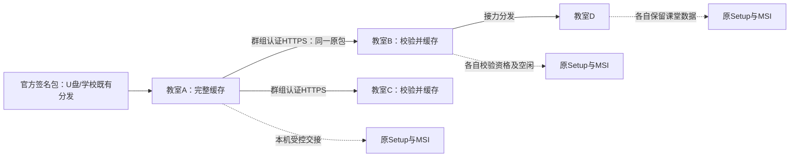
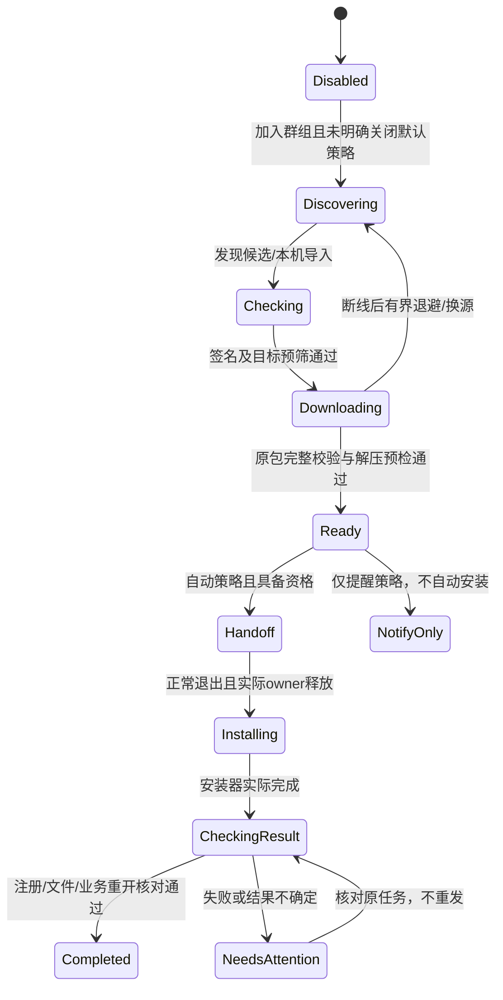

# D14：校内协同更新与安全分发

日期：2026-11-06（北京时间）。总计划增量：1.50 / D12＋D13＋D14。状态：**自动更新主链已交付：正式Win11自动安装、重启及更新后接力通过；高级发行维护与校园多机范围见第18节**。用户“开始开发”覆盖前轮仅计划限制，第17节保留早期状态，最新实际进度见第18节及实施记录。既有D12/D13工作继续有效。

用户目标：学校内网中，一台未来教室电脑取得新版后，其他电脑可以从它下载并跟随更新，降低逐机分发成本。推荐方案为“无固定中心的缓存协作＋官方签名校验＋各机独立安装”；不是把一台电脑的安装目录复制到其他电脑。需求R35、任务P14-01至P14-24、验收Q26-01至Q26-10为新增稳定编号，不改写历史任务数量和已通过证据。

D14是新增能力，不自动成为既有UI修复或原功能交付的新增等待前置；只有宣称包含D14协同更新能力的交付才必须满足本方案对应范围。已有D12/D13缺项也不由此自动算通过。

## 1. 交付范围与不能省略的首次部署

首版完整闭环包含：正式发布包签名、离线导入、学校更新群组、自动发现、完整包缓存与转发、断点下载、按本机策略安装、当前用户交接、失败与中断核对、Web设置与结果展示。无域名、无公网、无NAS和无常开中心均可使用；至少有一个持有完整包且开启共享的节点在线。

1. **先做一次具备此能力的基础版本部署。** 当前0.1.5 Showcase/既有正式0.1.4不能凭空监听新更新协议；须各机人工或通过学校已有软件分发工具部署支持D14的正式基础版。初始化沿用旧版数据保留要求，不以重置学校解决升级资格问题。
2. **安装后自动启用，无需首次配置。** 默认直接参与当前局域网的官方更新，不要求注册账号、管理员保存设置或首次创建/加入群组。独立“学校更新群组”仅用于可选隔离，由本机主管理员设置；已有独立组及明确关闭的策略保留。
3. 每个新版本只需将**完整官方签名更新包**送入其中一台电脑；可通过本机主管理员U盘导入，或由校外下载后带入。其他同范围电脑自动接收；默认范围为当前私网LAN，配置独立组时仅在同组内分发。公网检查不作为首版依赖，不在学校电脑默认新增外网访问。
4. 新包的其他完整持有者可继续分发；单纯“已安装新版本”但没有原始签名包的电脑不能当种子，不从运行文件反向拼装安装包。
5. 每个Windows登录用户部署独立判断；同一电脑的其他Windows账号不会因此自动被升级。关闭、休眠、未登录、程序未运行的电脑不被唤醒，下次正常启动后补发现；不擅自打开登录自启动。

首版不包含：跨学校分发、公网穿透、开关机控制、SYSTEM常驻升级服务、远程强制安装命令、教学数据互相复制、差分补丁、任意历史版本自动多跳、全校统一账号/教学数据库。可选固定种子地址属于本期；学校统一管理中心和远程批量控制另列后续范围，不依赖D13完整网关才能使用。

## 2. 默认行为与教师体验

**用户最新更正：安装时自动启用，无首次配置。** 默认策略enabled/download/share=true、AutomaticAfterDownload，未配置独立组即实际参与当前私网LAN发现/下载/分享/自动安装，不再休眠等待入组或管理员会话。已有明确关闭、私有组及原手动/维护窗策略不改写；安装后的初始化由正常产品完成，不在每次启动重置用户设置。不同Windows用户仍独立部署，操作系统/学校网络策略限制仍真实显示。

**2026-11-06开发中用户追加，覆盖本节早期默认：**D14必须自动下载及安装。启用学校群组更新后，检测到合格更高版本即自动下载、验签与核对本机资格，按`AutomaticAfterDownload`模式正常退出安装并立即重启；用户允许更新时短暂退出，不要求维护窗口、5分钟无输入或60秒倒计时。旧维护窗/手动策略只兼容读取，不自动改成自动安装；本次产品界面提供自动安装与仅提醒两种模式。交接仍必须等待writer/恢复/worker/audio/file owner实际归还；未知状态不能强杀清锁。Windows若要求UAC仍须真实确认，不能承诺绕过系统权限。未完成接线不把关于页的状态读取叫作真正检查/安装。

托盘新增“关于”，打开本机`#/about`，版本来自正在运行程序的`CARGO_PKG_VERSION`，提供“立即更新”和实际更新状态；不恢复原生设置窗口。按钮已接入实际后台检查，页面显示真实任务阶段；实际正式升级的验证状态见第18节及实施记录。

| 场景 | 默认行为 |
| --- | --- |
| 安装完成，未做任何更新配置 | 直接参与当前私网LAN更新，默认发现/下载/分享，合格包完成后正常安装并重启；不要求应用账号 |
| 可选加入独立学校群组，未另选策略 | 使用原默认自动下载/分享/安装，仅同组分发 |
| 已入组且保持默认策略 | 自动下载并分享校验完成的官方包；资格通过且真实owner归还后正常退出安装并立即重启 |
| 自动更新时仍有写入/恢复或worker/audio/file owner | 先正常取消/排空并等待实际归还；不强杀、不清锁，也不以端口断开当退出完成 |
| 读取已有手动/维护窗策略 | 保留原值且不自动安装；网页可明确改选自动安装或仅提醒 |
| 需要Windows提权或学校策略禁止无人值守 | 显示“等待Windows确认/由学校部署”，保留已下载包；不模拟点击UAC、不更改系统策略 |
| 更新未成功 | 可运行的原版本继续使用；待核对状态明确显示，停止自动重发 |
| 无可用种子/网络隔离 | 下次重试或导入U盘包，不影响当前教学 |

以下是早期维护窗模式的历史规则，不是当前自动安装模式的前置条件或已交付网页选项：维护时段初值20:00–06:00，**还须当前无课程、距下节至少30分钟、连续5分钟无系统输入，且无上述活动**，时间窗本身不等于可安装。系统时间回拨、课节不可信或活动状态未知时不自动安装，提示校正；不修改电脑时间。普通网页会话继续沿D12规则，空闲判断不引入5分钟重新登录。

默认策略为“自动下载、校验后安装并立即重启”；另保留“仅提示”“自动下载、手动安装”“自动下载、维护时段安装”供选择。用户托盘主动退出默认只退出，不偷偷变成安装操作；只有已经显示并获准的交接意图才进入更新。没有满足条件的空档就持续等待，不把“跟随更新”解释成全校同时强制停课。

## 3. 拓扑与发现

- 复用M11原网络循环及UDP38443 socket，增加独立魔数/版本的更新查询，不冒充Emby协议，不改变既有教室目录回复格式。更新消息上限和现有公开发现限额分别计数，未知版本不回复。
- 启动后随机延迟0–30秒查询；普通周期10分钟±20%抖动；完整新包就绪时仅通知已认证候选，其他节点再核实。UDP是提示，不承载完整元数据、安装命令或包正文；不周期广播整份版本清单。
- 发现请求带128位随机nonce和群组认证；应答绑定nonce、群组、临时节点ID、实际来源私网IPv4、更新HTTPS端口、证书指纹和协议版本。公开班级发现不泄露群组密钥；未经认证不公布更新缓存列表。
- 候选最多64个、90秒TTL；过期后需新挑战。相同包去重，优先可达且有空闲上传槽的来源，失败可换源；不做全网段逐IP扫描或复杂中心选举。
- 默认仅RFC1918、私有/域网络配置文件。跨VLAN仅使用管理员明确填入的私网种子IP和明确CIDR，逐项测试路由/ACL；UDP不能穿透网络隔离，禁止转发到公网、回环管理口、链路本地/云元数据地址或任意URL。
- 固定种子使用UDP38443单播认证挑战和TCP8445传输，两个方向所需规则都须可达；只开放HTTPS不能省略对端身份验证，UDP被拦时明确提示网络策略而非悄悄接受未认证证书。
- 教师入口停用与更新共享开关独立。共享同一网络循环/socket时按能力生命周期管理：教师入口关闭后不再公布教师地址，但已启用的更新发现仍可工作；两个能力都停用才释放共用资源。不新增第三个通用worker或每节点线程。

## 4. 三种信任分别处理

### 4.1 学校群组：哪些电脑可以互传

首次创建随机学校群组ID和256位随机群组密钥；配置文件包含群组ID、密钥、协议版本及可选私网种子。只允许本机主管理员明确导出/导入，文件提示“包含加入凭据，请勿公开”。不放在二维码、教师页面、公开目录、包缓存、日志或Git；导入后使用当前用户DPAPI保存。

群组HMAC-SHA256只证明持有加入凭据，不证明是官方发布者，也不授予教室账号/数据权限。丢失加入文件或退出群组可由管理员重新导入/明确替换；首版支持人工轮换整组凭据，不承诺对离线旧节点即时远程吊销。学校群组名称不是既有school/class ID的替代物，同名学校不自动互信。

### 4.2 无域名HTTPS：只给原生更新通道使用

更新文件走独立原生HTTPS监听，建议端口8445，端口冲突明确显示，不随机开放一串端口。每台电脑为更新服务独立生成私钥和带实际私网IP SAN的证书，私钥留当前用户受控密钥存储；IP变化重新准备证书与发现应答，不把一份共享私钥塞进安装包。

**明确的架构预算增量：**现有Schannel Driver只有本机/LAN两套服务端凭据。D14在同一SSPI线程增加`UpdateServe`和不带客户端私钥的`UpdateFetch`角色，凭据句柄总上限由2调整为4；不是要求原两槽凭空承载第三张证书。只增加必要角色，不新增SSPI/网络线程，不扩大现有TLS context/连接总槽。四槽计入仍被context持有的退休凭据，本机/教师维护优先，更新让出额度。更新证书切换必须先关闭准入并实际排空旧更新context/凭据，未归还不得再分配替代句柄；不加无限退休凭据队列。P14-01/05需把这一例外落到确切类型、额度与测试，D12其他预算不变。

原生下载器按经过群组HMAC认证的指纹**精确固定对端证书**，并完成TLS握手、证书用途、算法、有效期及IP约束检查。此处信任根来自管理员事先导入的学校加入凭据，而不是来自一条公开UDP回复。认证挑战短时有效，实际连接目的地址必须等于已验证来源；证书变化必须重做挑战，不能自动接受。

该更新专用验证器使用Schannel显式验证接口，不以“忽略所有证书错误”替代验证；不影响教师Web/PWA、学校CA或本机管理的证书策略，不向Windows系统根证书库批量导入同伴证书。手机浏览器不访问8445，所以无需为每个缓存节点给手机安装证书；也不依赖尚未完成的D13学校CA。时间错误时暂停连接/安装并提示，不降级HTTP。

Schannel手动验证意味着调用方必须承担完整验证责任，接口参考[Microsoft：手动验证Schannel凭据](https://learn.microsoft.com/en-us/windows/win32/secauthn/manually-validating-schannel-credentials)。P14-05先证明验证闭环，不能以关闭证书检查作为临时交付。

### 4.3 官方发布签名：哪些包允许安装

采用[TUF 1.0.36](https://theupdateframework.github.io/specification/v1.0.36/)的Root/Targets/Snapshot/Timestamp元数据角色和验证顺序，复用维护中的实现，不手写密码算法或另造JSON签名规范。基础安装包内置可信根公钥；首版以Ed25519验证为候选，精确实现/依赖及Win7构建资格在P14-02冻结，未证明前不能标已选型通过。

- 离线根密钥与日常发布密钥分离；根角色拟2/3门限，日常发布角色独立受控保管。私钥只在发布环境，不在教室、学校群组、Web后台或Git；日常部署不要求学校持有发布私钥。
- 发布元数据包含产品ID、通道、严格递增releaseSequence、可读版本、目标OS/架构、安装器ABI/能力、允许前驱指纹、最小升级协调器版本、数据/协议兼容范围、包长度及SHA256。不同构建即使版本名相同也必须有不同发布身份；同sequence不同hash拒绝。
- TUF快照绑定具体Targets，防止混搭；客户端持久记录已接受元数据版本及本机已安装releaseSequence，拒绝回退、越过根轮换链和未授权目标。先验签和检查有界长度，再信任发布内容。不可用“自签发布者”“同学电脑已装过”或仅SHA256替代官方签名。
- 元数据有效期初值：Timestamp90天、Targets1年、Root5年，正式发布时校准；到期只暂停新更新，不停用已安装产品。离线学校通过新鲜签名元数据/U盘更新，不为续期强制联网、不自动延长旧元数据。
- 记录最大已接受时间，系统回拨或可信时间不足时暂停自动安装并明确提示；不能在完全离线且无可信时间/新来源时宣称已发现全球最新版或彻底排除冻结攻击。删除本机防回退记录后的首次信任仍依赖受信安装基线，不能保证对本地管理员篡改的抵抗。
- 轮换根须有旧根和新根满足各自门限的完整逐版本链；本次导入最多32个根版本，超过时走人工可信基础版升级，不跳过中间签名。签名拒绝/撤回声明与离线包一起携带；无联网渠道时不承诺即时获知官方撤回。

Windows可执行文件Authenticode、现有Setup/MSI封条与TUF发布签名分别核对，互不替代；不能因传输认证通过就允许执行。

## 5. 正式包和升级资格

**完整更新包必须保留原封不动的安装源**，并明确区分两层，避免签名元数据hash自指：

- TUF的签名目标是不可变`payload.zip`，只含固定同目录`Setup.exe`＋`FutureClassroom.msi`及许可/内层清单；签署它的元数据在ZIP之外。在线缓存、release描述、blob hash、ETag和Range均指这个payload，不指包含自身签名的文件。
- 离线运输包可为`.fcupdate` ZIP envelope，含`metadata/`和原封不动的`payload.zip`。导入先有界读取并验证元数据，再核对payload长度/hash；envelope自己的hash仅作运输核对，不冒充TUF目标身份。

不修改内层封条，payload hash和Setup绑定的MSI hash分别校验，任何混搭拒绝。两层解压都只接受发布清单白名单、常规文件和有界相对路径，拒绝绝对路径、`..`、重解析点、重复项、大小膨胀及可执行额外脚本；仅允许上述明确的一层payload嵌套，不递归任意解包。

现有源码的源文件上限64MiB、载荷上限30MiB、内层manifest上限32KiB继续有效。payload及离线envelope各自上限初值128MiB，且每件内层文件仍须满足更小的原安装器上限；临时解包与原包同时存在计入同一磁盘预留，不能借更新服务绕过现有封装预算。读取原源上限的事实见`installer_lifecycle/native/broker/source_package.rs`和`broker/manifest.rs`，实施若需改上限须另列依据，不默认扩容。

升级资格由新包的`PublishedPredecessor`与实际旧部署的产品/包、缓存MSI、模板/guard和逻辑摘要共同决定。仅版本号更高不构成资格；外层描述只用于预筛，原Setup再次权威验证。首版单跳升级，无直达资格时明确“需中间正式包/人工处理”，不重打旧包、不强制覆盖。旧FCLM73、缺前驱资格的旧ABI2、GNU Showcase/开发ZIP不自动提升为正式受支持来源。

基础版引入D14时须发布明确的支持起点/前驱矩阵及安装说明；不能把当前展示机替换EXE的做法包装成正式自动升级。

## 6. 缓存、断点与接力分发

- 存在当前用户独立更新缓存目录，与学校资料、普通备份和安装目录分开。按包内容hash定址，`partial`与`ready`物理分开；原子完成标记前不得对外提供。
- 客户端先验证有界TUF元数据，再预留磁盘空间；流式下载，SHA256完整核对、严格白名单解压和内层源预检完成后，才进入Ready并成为分发点。下载一半的文件不转发。
- HTTPS仅提供群组认证后的只读版本目录、签名元数据和已完成包；不提供上传、远程命令、任意路径或教学资料。导入是本机授权操作，不能从网络上传一个ZIP就触发执行。
- 原包使用强ETag（内容SHA256）、精确长度及单段HTTP Range；拒绝多Range、压缩变体、长度变化、任意重定向。断点记录绑定releaseId/hash/总长，换源必须同一hash和强ETag；继续下载前重新检查元数据。重启后对已下载前缀重新流式校验，不信任保存的hash计算器内存。
- 首版只下载完整包，不做分块洪泛、多源并行拼接或差分patch；断点续传已经能减少重复分发。每个节点下载就绪后可接力，无安装成功先决条件，但本机仍独立验证资格。
- 当前及上一版的完整维护源固定保留；其他包按LRU在2GiB总配额内回收，保护安装/传输/修复占用者。空间不足明确暂停，不删除课堂原件、当前维护源或正在使用的文件。

## 7. 本机受控安装与失败恢复

1. 沿原Web权限用例取得一次本机更新意图，绑定更新策略修订、releaseId、准确当前安装身份和当前Windows用户。发现节点不能发送“立即安装”命令。自动策略的既有授权不是教师账号密码，也不替代系统权限。
2. 当前用户启动`fc-bootstrap` crate内独立、一次性的受控更新协调器二进制。协调器是普通用户权限，不设SYSTEM服务/全局计划任务；保留同一token/SID、HKCU、DPAPI、证书、自启动与快捷方式归属，不接受外来SID/任意安装路径/shell文本。
3. 协调器只从当前SID固定私有目录读取由本机策略用例产生、私有ACL和DPAPI保护的任务记录，绑定jobId/policy revision/deployment/release；这不是官方发布者签名，也不能由学校共享密钥签发。先验证自身安装归属、原包和升级资格，再通过既有退出编排正常排空写入、音频、网络、worker及文件owner。旧sole-writer实际关闭前协调器只读，关闭后经独占维护锁接管任务记录写owner，不能同时开两个写进程。只发出退出意图不算退出；原startup lease仍在、安装Pending未结算、数据迁移不兼容或任何owner未归还时拒绝进入安装，不强杀、不删除锁、不让Restart Manager代关。
4. 交接前保留准确旧版完整源、数据兼容说明及必要恢复材料。以现有安装器固定`install`意图调用**新包自己的Setup**，不编造`upgrade`参数，不直接启动内层MSI，不传下载端给出的命令行。
5. 每用户安装遵守Windows现行权限与UAC。应用主管理员授权不能让系统自动提权；需要UAC时等待用户确认，拒绝/超时则回到可用旧版或待处理。首版不改AlwaysInstallElevated等系统策略；学校确需无人值守时，使用已授权且经实测可行的每用户路径或已有学校部署工具，不以网络程序绕过。
6. Windows Installer的per-user/per-machine由包和系统属性/权限共同决定，不能从“装在LocalAppData”推断必然免UAC；参见[Microsoft ALLUSERS说明](https://learn.microsoft.com/en-us/windows/win32/msi/allusers)及[Installer与UAC](https://learn.microsoft.com/en-us/windows/win32/msi/using-windows-installer-with-uac)。现有固定perUser/NOT ALLUSERS、拒绝服务账号及源资格检查继续保留。
7. 安装结果以原生持久事务、实际注册/文件/封条回读及产品重开为准。Setup已启动、退出码单独为0或HTTPS连接恢复都不单独标记成功。产品重开要核对声明的新版本、schema、当前班级、数据可读及Web静态资源版本一致；不新增老师口令要求来完成机器健康判断。
8. 迁移仍由原sole-writer/恢复协调器执行。账号/凭据、任教/默认老师、课表、布局、资料原件/索引、设置和命令历史须保留；D14自身的策略、DPAPI群组密钥、防回退记录、完整维护源及未结算任务也必须跨升级/回滚保留。下载器、种子、更新协调器不直接改学校数据库。Web静态资源随本机程序成套更新，不单独推一个前端版本。清除学校或跨校重绑时暂停协同更新并要求显式重新加入群组，未结算原生安装记录不能借重置删除。
9. **程序回滚与数据回滚分别判定。** MSI事务失败用原回滚路径；若新版已迁移到旧版不可读schema，不得只启动旧EXE。需要时停在维护状态按原恢复流程处理，普通`.fcbak`不能代替完整账号/历史恢复材料。不宣称任意版本都可一键降级。
10. 中断后保留本机UpdateJobId、阶段、来源hash和原安装事务关联，先核对原结果；不能重启就自动重复安装。新包失败有界退避，签名/资格错误进入人工处理而非循环执行；群组其他电脑不因某机失败都停止教学。

## 8. 数据与接口契约

更新状态与教学业务分离，避免下载进度让课表/桌面authority全局revision持续改变。原子策略/任务记录使用当前用户独立维护存储，所有写仍经现有sole-writer/维护存储端口串行；不增加常驻数据库线程，不往教学文档夹带包正文或瞬时进度。

| 对象 | 必要字段/约束 |
| --- | --- |
| UpdatePolicy | 独立revision、群组引用、通道、下载/分享开关、安装方式、维护时段、CIDR/种子、限速；群组秘密仅密钥引用 |
| ReleaseDescriptor | 官方签名身份、sequence、系统/架构、bundle hash/长度、内层文件hash、精确前驱摘要、ABI、协调器/数据/协议兼容范围 |
| PeerCandidate | 随机节点ID、IP/端口、挑战及证书指纹、到期时刻、当前失败/传输槽；候选不提供可信可执行路径 |
| UpdateJob | 随机jobId、policy revision、releaseId、本机部署身份摘要、阶段、原生事务关联、结果/未知原因；不保存命令行凭据 |
| CacheEntry | 内容hash、长度、完整标记、正在使用计数、维护源保护及最后访问；传输关闭才释放物理文件owner |

本机管理路由草案为`/fc/api/v1/updates/{status,policy,check,import,prepare,postpone,reconcile}`，沿原本机主管理员、页面会话、CSRF、CAS及类型化命令发行规则接入；具体method在P14-04冻结，写操作禁止GET。离线导入使用明确本地文件选择/有界流式上传，不接任意路径；部分ZIP不落入业务资料接口。

更新监听8445仅提供`/update/v1/challenge`、`/update/v1/catalog`、`/update/v1/metadata/...`、`/update/v1/blobs/{sha256}`；挑战用于双方认证和当前连接token，目录/下载均需要群组证明，token短时绑定节点和连接上下文；没有管理写路由，不携带教师Cookie。后续端点细节以有界DTO、鉴权和线程预算一起冻结，不把此草案当已开放API。

错误至少区分：未加入群组、对端不可达、群组/证书失败、签名失败、元数据到期/回退、系统不匹配、前驱不合格、空间不足、教学忙、等待系统确认、原事务待核对、数据迁移不兼容。界面显示可操作的中文原因，敏感路径/密钥/账号凭据不出日志。

## 9. 十二crate架构落点

| 位置 | D14职责 | 不允许进入的内容 |
| --- | --- | --- |
| fc-domain | 发布/策略/任务ID、目标匹配、空闲判定、纯阶段规则与有界值 | serde、SQLite、socket、Windows句柄 |
| fc-ports | 更新缓存、签名验证、群组密钥、传输、安装交接和结果回读端口 | 具体操作系统类型、任意shell/path接口 |
| fc-application | 本机策略鉴权/CAS、准备/推迟/核对用例、空闲安装决策 | 平台或存储反向依赖 |
| fc-security | 群组HMAC、官方元数据验证适配及信任根轮换规则；DPAPI通过端口 | 发布私钥、网络下载、Windows存储句柄 |
| fc-protocol | 发现/HTTPS/本机Web严格有界DTO和错误映射 | 信任UDP即授权、直接执行安装 |
| fc-runtime | 取消、代次、下载/共享并发额度、诊断和停止所有权 | 每连接线程、隐式无界队列 |
| fc-storage | 独立维护策略/任务/防回退记录、原子提交和恢复关联 | 包正文入教学库、第二个常驻writer |
| fc-windows | Schannel/socket、受控缓存文件、系统输入/会话、退出与原Setup交接/回读；原SSPI线程最多4个明确角色凭据，context总槽不扩 | 由网络请求指定SID/路径、SYSTEM代装 |
| fc-bootstrap | 注入用例/端口，组合原网络循环与双worker；独立一次性协调器bin | 第十三生产crate、常驻新更新服务 |
| fc-presentation＋web/src | 更新中文状态、策略/缓存/导入/推迟/结果页及托盘入口 | 原生管理设置UI、公开网页安装权限 |
| fc-materials / fc-audio | 只通过既有活动/停止契约配合空闲与排空 | 承载软件更新ZIP或承担安装职责 |
| scripts/packaging / CI | 正式完整源、签名元数据、前驱矩阵、发布工件与维护源留存 | 教室侧发布签名私钥或临时开发目录冒充正式源 |

新增依赖必须落在已有允许方向；fc-windows不依赖fc-security，由bootstrap构造验证端口注入；固定小包HMAC可经纯内存验证端口在原网络循环执行，禁止在其中读库/跑KDF/验整包签名；大文件和发布校验按共享工作池额度执行。签名实现若同时解析TUF，封装为security内部基础设施细节，经端口返回领域结果，不让domain依赖序列化。每次实现后运行`python3 scripts/check-architecture.py`，不把计划表当作架构检查通过。

## 10. 初始预算与清理

以下为首版设计初值，P14-01核对现有真实总配额后冻结；更小的原总上限优先，不把每项初值相加当成允许扩容。唯一已明确需要的凭据槽增量为第4.2节的2→4，其他限额不随之放大。

| 资源 | 初值/边界 |
| --- | --- |
| UDP | 请求≤256B、回复≤1024B，每次poll最多8包，每节点应答≤8次/秒；认证失败不放大回复 |
| 元数据 | 单件≤256KiB、一次候选元数据合计≤2MiB、catalog最多16个发布；根链≤32版本 |
| 缓存与包 | 总2GiB，payload及离线envelope各≤128MiB；内层每件源≤原64MiB、实际产品载荷≤原30MiB；payload解包总量≤签名内层清单之和，避免把安装源容器与安装后载荷混为一个上限 |
| TLS凭据 | 同一SSPI线程现行2槽扩至最多4槽：Local/Teacher/UpdateServe/UpdateFetch；原context/连接总槽不扩，旧owner未归还不补位 |
| 并发 | 每机1个下载任务、最多2个上传；共享原网络总连接/首头配额，无余量返回Busy，保留教师及本机管理额度 |
| 吞吐 | 下载4MiB/s、上传合计2MiB/s；上课/语音活动降至下载1MiB/s、上传512KiB/s或暂停，管理员可调但受全局上限 |
| 内存/工作池 | 文件64KiB缓冲，更新额外常驻内存目标≤4MiB；不整包进内存，同一时刻最多1个更新工作项占用原共享池，分片让出 |
| 超时/重试 | 连接5秒、无数据15秒、单次传输10分钟；失败5/15/60秒退避后回普通发现周期；不改变原教师首头5秒契约 |
| 退出 | 发出正常退出后最多等待30秒，未实际释放则停止交接并保留原程序，不强杀；物理owner不因超时归还额度 |
| 日志/任务 | 脱敏事件最多128条、历史任务最多32条；未结算安装任务不淘汰，不用淘汰清除Pending |

下载/上传取消后，socket、文件句柄、工作票据实际归还才释放额度。开启共享时仅为本程序UDP38443/HTTPS8445准备精确私有/域、RFC1918或明确CIDR规则；需要Windows管理员时说明固定动作，不停防火墙、不改SSH、不放开公网。不因关闭更新服务删除教师8443、他人规则或用户证书。

## 11. Web设置与中文状态

全局设置新增“软件更新”：当前版本/通道、学校群组、来源、包大小与进度、安装策略/维护时段、限速、可用缓存及结果。提供“创建/加入学校群组”“导入官方更新包”“立即检查”“现在更新”“推迟”“暂停共享/下载”“核对上次结果”。创建/导入/策略变更必须主管理员，普通教师只能看到公开的维护提示，不能导出加入凭据或触发安装。

“现在更新”先展示实际升级路径、将正常退出、需Windows确认的可能性及数据保留状态；不在用户选择后突然删资料或转换安装归属。教学忙时说明具体原因，不能只显示一个专业错误码。下载完成显示“已下载，等待空闲”，不能显示“已更新”。

托盘可加“软件更新”直达本机Web对应页；本轮不要求新增图标，后续如需新项目图标按既有imagegen规范制作。保留“查看状态/设置/快捷连接/退出”及当前桌面交互，不建立第二套原生管理UI。

## 12. 详细任务拆解

任务建立时均为`NOT_STARTED`，当前分项状态见第17节。规模S/M/L只表示相对改动面，不承诺日期或人日；完成后登记实际代码、构建、局部运行和剩余限制。

| ID | 前置 | 主责/规模 | 明确交付与完成条件 |
| --- | --- | --- | --- |
| P14-01 | 无 | bootstrap/packaging，M | 核对真实安装上下文、64MiB/30MiB源限制、网络/worker/内存预算，冻结同SSPI线程2→4凭据角色及旧owner回收；冻结首个支持前驱及D14基础版引导矩阵，开发目录明确排除 |
| P14-02 | 01 | security/CI，L | 固定TUF实现/算法/根角色与密钥保管方案，Win7目标兼容检查；负向签名、根轮换与到期/回退验证闭环，发布私钥不进入产品 |
| P14-03 | 01、02 | scripts/packaging，M | 正式Setup/MSI不可变payload ZIP＋外置TUF元数据生成/签名，离线envelope封装两者；绑定准确前驱/target hash/格式范围，产物无hash自指，生成签名拒绝清单 |
| P14-04 | 01 | domain/ports/protocol/storage，M | 定义独立UpdatePolicy/Job/Cache接口、CAS及结果码，本机授权路由；独立维护存储不会推进教学authority revision；线程所有权有唯一归属 |
| P14-05 | 02、04 | security/windows，L | 群组/DPAPI、HMAC挑战、节点证书及更新专用Schannel客户端/服务端角色和验证器；凭据最多4个且真实排空，伪回复/错误指纹/无加入凭据拒绝，无HTTP降级 |
| P14-06 | 04、05 | windows/runtime，M | UDP共享socket版本分流、随机查询、64候选/TTL、教师与更新独立开关、固定种子；不加扫描/线程，不泄露群组秘密 |
| P14-07 | 03、04 | windows/storage，M | 内容hash缓存、空间预留、原子ready、源保护/使用计数/LRU；损坏/未完整包不共享，清理不碰学校资料 |
| P14-08 | 05、07 | windows/protocol，L | 独立8445只读更新宿主、群组认证目录/元数据/blob与Range；无上传/任意路径/安装路由，流式发送受总预算 |
| P14-09 | 02、06、07、08 | windows/runtime，L | 单包断点下载、强ETag换源、长度/hash/解压白名单及元数据二次校验；断网重启能继续，同一时刻仅一个下载 |
| P14-10 | 06、09 | application/runtime，M | 发现候选到完整包接力编排、限速/抖动/退避/暂停共享；无中心或最初种子退出后其他完整持有者可接力 |
| P14-11 | 03、04、07 | application/windows，M | 本机准确目标/前驱/ABI/schema资格预检；来源宣称新版但无完整包或不匹配时不安装，给出下一步 |
| P14-12 | 04、11 | application/bootstrap，M | 自动策略不等待维护窗、空闲或倒计时；实际writer/恢复/音频/worker/file owner归还后交接，旧策略兼容读取 |
| P14-13 | 01、03、11 | bootstrap/windows，L | 一次性同用户协调器、SID私有ACL/DPAPI任务记录、sole-writer实际关闭后独占接管任务写owner、Setup调用/UAC分支；不使用发布/群组密钥授权本机执行，无任意命令/SYSTEM服务，部署用户归属不变 |
| P14-14 | 12、13 | bootstrap/runtime，L | 产品正常退出、实际lease/owner释放、安装协调器接管和受控重启；Busy/Pending不强清，不由端口关闭推断退出 |
| P14-15 | 03、13 | storage/windows，L | 支持前驱的完整数据保留/迁移矩阵，失败后程序与数据分别核对；旧源及恢复材料可用，未知/不兼容schema明确停留维护 |
| P14-16 | 14、15 | application/storage，M | 持久job阶段/原生事务关联、重启核对、回读版本/注册/文件/Web及数据状态；未知不重发，退出码不单独当成功 |
| P14-17 | 04、05、09、11 | presentation/web，M | 群组/导入/进度/资格/缓存页面与中文错误，主管理员权限及页面会话沿原契约；不把下载完成当安装完成 |
| P14-18 | 12、16、17 | web/bootstrap，M | 自动安装/仅提醒、下载与分享开关、真实状态及托盘关于/立即更新；UAC或失败原因可见，不恢复原生设置UI |
| P14-19 | 01、05、08、13 | windows/packaging，M | 精确防火墙准备、证书/密钥归属与卸载清理；自动安装能力在有/无提权条件下分层记录，不更改学校系统策略或SSH |
| P14-20 | 02、03、05、11 | tests，M | Q26-01/02/03安全、回退、权限及资格组合检查；开发包/错配源永不执行，复用已有未变安装器负向证据 |
| P14-21 | 06–10、17 | tests，M | Q26-04/05/06发现、换源断点、缓存/磁盘/配额、UI测试；至少两个隔离节点逻辑互传，不能用单节点冒充传播 |
| P14-22 | 14–16、18、19 | Win11隔离集成，L | Q26-07/08/09：一条真实合格升级、一次失败/中断核对、当前用户归属和数据保留；现有Win11完成受影响最小链 |
| P14-23 | 10、18、20–22 | 集成，M | Q26-10两节点A导入→B下载→B作为新种子→C接力与空闲安装；无多台设备时允许单机独立网络/数据实例证明分发逻辑，但真实多机校园效果明确NOT_RUN |
| P14-24 | 03、19–23 | packaging/docs，M | 生成可用正式签名分发包、首装群组说明、兼容前驱矩阵与恢复说明；清理测试数据/任务/进程，dist交付、代码同步，分项证据不冒称全部完成 |

关键依赖：`01 → 02/04 → 03/05 → 06/07/08 → 09/10`完成“可安全分发”；并行推进`11 → 12/13 → 14/15 → 16`完成“本机可安全安装”；`17/18/19`把两条链接入产品，`20–24`完成必要集成与交付。不能先开放自动执行，再补签名或升级资格。

## 13. 分阶段可评审成果

| 阶段 | 任务 | 可见成果 | 尚不能声称 |
| --- | --- | --- | --- |
| A：可信发布与首装基线 | 01–05 | 能导入/识别一个官方包，明确首装群组及支持前驱 | 其他电脑已会自动更新 |
| B：内网分发 | 06–10、17部分 | A提供包、B断点下载并转为种子，可关最初A继续分发 | 下载完成就是已安装 |
| C：本机升级 | 11–16、19部分 | 同用户、合格源、正常退出、实际安装与结果核对闭环 | 任意老版本/任意系统都可无人值守 |
| D：学校使用流程 | 17–19 | 中文群组/自动或仅提醒策略/状态与首装说明 | 已有远程全校控制中心 |
| E：必要验收与交付 | 20–24 | 定点结果、正式分发包、实际限制及清理同步 | 缺设备的系统或校园网络已经实测 |

A/B可先演示下载共享，但D14整项完成必须包含C–E。阶段不代表另发一个没有安装闭环的Beta，也不要求重复未变的安装/音频/PWA全矩阵。

## 14. 最小验收清单

| ID | 场景 | 必须结果/证据 |
| --- | --- | --- |
| Q26-01 | 篡改包、错误签名、元数据混搭、同sequence异hash、根链缺失/到期 | 不标Ready/不执行；到期不关闭原产品 |
| Q26-02 | 假UDP、不同群组、回放nonce、错证书/IP、公开目录/教师Cookie误用 | 未取得群组与精确证书验证不能下载；不能获得安装/教学权限 |
| Q26-03 | 高版本但错OS/架构、旧FCLM73、GNU Showcase、错MSI/前驱、系统时间回拨 | 明确不合格或待处理，不强制覆盖或跳过规则 |
| Q26-04 | A导入、B发现、跨VLAN固定种子、教师入口关闭、两功能都关闭 | 按明确生命周期可发现/停止；隔离网络不冒称穿透 |
| Q26-05 | 传输断线、换源、重启、ETag改变/内容损坏 | 同内容可续，不同内容重做，不转发partial |
| Q26-06 | 磁盘不足、缓存已满、连接/worker繁忙、同时教学 | 有界暂停/退避，保留教学/维护源；声音/桌面不因更新任务阻塞 |
| Q26-07 | 上课/录音/未停writer/原lease持有、UAC取消/无权限 | 不安装或等待确认，原产品可继续；不强杀、不修改系统策略 |
| Q26-08 | 一条合格正式源成功升级，同用户重开 | 实际版本/注册/资源与Web一致，账号/任教/默认老师/课表/布局/原件/索引/命令历史及自启动归属保留 |
| Q26-09 | 安装失败、断电模拟或协调器中断、迁移不可降级 | 原结果可核对、不自动重发；仅在数据兼容时恢复旧程序，不伪称MSI回滚等于数据回滚 |
| Q26-10 | B下载后作为种子、A离线、C后启动、局部失败/暂停分享 | 现有完整种子可接力；各机独立决策，不全校循环重启，停用不影响现有教学 |

只跑与实际变更直接相关的现有/新增检查；开发中优先纯规则和隔离流测试。Windows 11用现有授权机器完成受影响本机链，运行观察不超过用户指定5分钟；不安排72小时或额外压力归档工程。Win7/Win10保留兼容设计、目标构建/导入检查，当前及后续实机NOT_RUN（用户不安排），不等待设备、不拿Win11替代；ARM64另定。

同一Win11上的A/B/C隔离实例只证明协议与协作逻辑，不能证明多机、无线隔离或跨VLAN；可用注入传输或隔离端口模拟，不为测试改用户网卡/架设VLAN，也不把模拟传输当真实LAN通过。产品监听和每用户独占安装分别核对。未来真实部署的校园连通性单列结果；缺现场证据时交付说明必须写明实际覆盖范围，不将它变成可进行代码开发的等待项。

## 15. 风险、停止条件和状态记录

| 风险 | 处理/停止条件 |
| --- | --- |
| 初始老程序不支持发现 | 必须一次部署D14基础版；不能声称无须逐机首装即可升级所有历史程序 |
| 签名库/算法或TLS证书验证不能满足目标构建 | P14-02/05不通过就不开放自动执行，不用忽略证书或自研密码学顶替 |
| 当前正式源需UAC，学校没有无人值守授权 | 交付自动下载＋等待系统确认，明确能力限制；不能冒称全自动安装已通过 |
| 其他学校/恶意同网节点 | 群组加入、对端证书固定和独立官方签名；共享密钥泄露不授予发布权限，需人工轮换 |
| 缓存传播坏版本 | 官方签名只证明来源，不证明无业务缺陷；使用独立测试通道、少量指定教室试装后学校再启用稳定通道，保留撤回元数据与失败阻断 |
| 包资格不匹配或原维护源缺失 | 停在人工处理，不猜测前驱、不删数据；原官方源可离线补充 |
| 镜像只提供陈旧但未过期包 | 本机防回退拒绝已知旧版；隔离学校不能证明全球最新，允许管理员带入新元数据和包 |
| 安装/数据结果未知 | 持久记录并核对原事务，不用重复执行作为恢复手段 |

所有任务按`NOT_STARTED / IN_PROGRESS / IMPLEMENTED / VERIFIED / BLOCKED`分别登记；设计完成、host通过、目标构建、Win11单机、真实多机/校园、正式包资格分列。此文不能作为任何新功能已开发或已部署的证明。

## 16. 本轮计划交付及后续起点

本轮交付详细方案、24项任务、10组验收、架构与主导航同步；不签发真实发布密钥、不导出学校凭据、不改测试机网络、不部署更新服务。后续开发从P14-01开始，先冻结真实安装资格/预算和可信包验证，再进入分发与安装链。

依据：现有[架构表](01-模块划分与接口契约.md)、[Rust依赖方向](07-Rust开发与验证计划.md)、[发布门槛](09-Rust构建验证与发布门槛.md)、[D12升级数据与本机管理边界](28-Web管理与桌面常驻调整方案.md)、[D13发现及无域名环境](29-校内PWA与教室发现及证书方案.md)，以及本文各节链接的TUF和Microsoft原始资料。外部规范用于约束设计，不代表本项目已经符合规范或通过实现验证。

## 17. 首批实现与接口冻结（2026-11-06）

用户已授权开发。以下是可复用的实际代码，不是已开放的产品入口；尚未生成或部署D14正式基础版，不替换授权Windows当前运行程序，也未签发真实发布密钥。

| 任务 | 当前状态 | 已实现 | 尚缺的完成条件 |
| --- | --- | --- | --- |
| P14-01 | IN_PROGRESS | 核对原源文件64MiB、安装载荷30MiB、TLS context总4槽、共享worker 2线程；Showcase/无前驱证据明确拒绝资格 | 四凭据角色实现、正式基础版及精确前驱发布矩阵 |
| P14-02 | IN_PROGRESS | 有界同步TUF验证、Ed25519、根轮换/门限/防回退/到期；从安装锚回放checkpoint恢复信任，不启动网络或运行时线程 | 可信checkpoint持久化接线、正式目标资格与生产根/发布密钥保管落地 |
| P14-03 | IN_PROGRESS | 不改payload字节的离线envelope创建/只读检查脚本，结果明确TRANSPORT_ONLY | 正式Setup/MSI准入、TUF签名发布链及撤回元数据 |
| P14-04 | IN_PROGRESS | 更新策略/任务/命令记录、独立revision/CAS；原SQLite writer专用维护消息及维护表，不发布教学authority | Web命令发行/路由、后台结果capability与可信元数据持久化 |
| P14-05 | IN_PROGRESS | 不可Debug/序列化的群组密钥包装、零化及HMAC证明；不授发布/安装权限 | DPAPI加入配置、节点证书及Schannel收发角色/验证器 |
| P14-06 | IN_PROGRESS | 定长版本化发现报文、nonce/群组/实际源IP/指纹绑定；原UDP socket支持教师/更新响应独立分流，共享8包/次及8回复/秒预算 | 更新开关接线、查询抖动、候选TTL与固定种子编排 |
| P14-07 | IN_PROGRESS | hash寻址、64KiB流写/可取消重哈希、断点恢复、必需源预检后原子Ready、2GiB/256条缓存、LRU/当前前版/实际读owner保护 | 私有目录/实际实例lease接线、TUF及原生安装源预检接线 |
| P14-11/12 | IN_PROGRESS | 严格版本/sequence/hash冲突、平台及精确前驱预筛；跨午夜维护窗口与教学/空闲阻塞规则 | 实际原生观测、活动快照、倒计时后二次校验及安装交接 |
| P14-17/18 | IN_PROGRESS | 托盘“关于”直达本机Web、实际版本/更新状态和立即更新入口；AutomaticAfterDownload策略及兼容存储，正常交接只等待真实owner归还 | 群组/更新设置、真实检查/下载安装编排及状态反馈；当前按钮明确说明未就绪 |
| 其余P14任务 | NOT_STARTED | 不以基础模块替代集成 | 按第12节依赖继续实施 |

**TUF选型。** 固定`sigstore-tuf/sigstore-crypto/sigstore-types=0.15.1`，前两者关闭默认特性，经库支持的CryptoProvider使用既有`ring=0.17.14` Ed25519验证与SHA2摘要；不启用其HTTP客户端/Tokio/aws-lc。依据为[上游TUF实现](https://github.com/sigstore/sigstore-rust/tree/fc308a2f0bcef92f10c199c6d75fa72441b329f7/crates/sigstore-tuf)及锁定源码。拒绝未知签名算法，不自行实现密码算法/签名canonical JSON。适配器对已验角色补充`now >= expires`到期拒绝，并在解析前拒绝重复/转义等价JSON键及过深输入。checkpoint恢复仍要求受保护的安装锚、根链/元数据及最大接受时间；单独重建根会丢失版本下限，不能当生产重启路径。当前GNU x86产品及独立Win7 GNU补充目标安全测试程序构建通过，后者PE32静态导入未见所核查的ProcessPrng/WaitOnAddress/GetSystemTimePreciseAsFileTime等现代API。补充检查不代表正式Win7 MSVC最终产品资格，新间接`tempfile/getrandom`等依赖仍须在该最终链接物上检查；不安排Win7/10实机。

**发现报文。** `FCUPDISC`＋版本1＋类型1查询/2回复。查询90字节，回复128字节；包含group/node/nonce各16字节，回复另含私网IPv4、非零端口、DER证书SHA256。最后32字节为带独立用途前缀的HMAC-SHA256；无效报文不应答。接收回复须匹配当前随机nonce和实际UDP源地址；协议不会据此信任发布包。当前生产网络循环仍使用原教师发现路径，新增更新分流接口未启用。

**签名目标custom。** `fc-protocol::update_release::ReleaseClaims::from_verified_custom`只接已验TUF目标的custom、length、SHA256，schemaVersion=1；包含releaseId/product/channel/releaseSequence/version、minimumWindows/architecture、ABI2/capability3、minimumCoordinator、sourceSchema/sourceProtocol范围及最多16个完整allowedPredecessors。摘要为小写hex，GUID为小写规范文字顺序；保留原MSI/envelope/template/guard/logical及来源证据，不以可读版本替代资格。解析成功不能代替TUF或Setup准入。

**运输工具。** `python3 scripts/package-update-envelope.py create --payload payload.zip --metadata-dir metadata --output release.fcupdate`，只读检查为`inspect release.fcupdate`。外层仅`payload.zip`、`metadata/{timestamp,snapshot,targets}.json`及可选最多32个连续`N.root.json`，均ZIP_STORED；拒绝ZIP64、重复、链接、额外路径及不一致结构。内层固定Setup.exe/FutureClassroom.msi和可选许可证/manifest，原64MiB源限制保留；许可证独立最多30MiB以容纳现有真实第三方声明，不放宽256KiB元数据预算。流式检查结构、长度和CRC，**没有验证TUF、Authenticode、MSI内30MiB载荷或前驱资格**，也不解压/执行安装文件。

下一步优先把受保护群组配置、更新HTTPS凭据与有界下载接到现有网络/worker，再接本机网页和同用户协调器。未接通前不开放自动执行，不把现有开发ZIP转换成官方种子。

## 18. 2026-11-06 产品接线与交付口径

本节接续第17节的历史状态，按用户“完成该模块”继续实现；第16节旧的“仅计划、不签发密钥、不部署”不再限制本次授权开发。完成代码、构建和Windows运行分别记录，不用基础模块或按钮替代真实升级结果。

- 原网络循环新增独立更新8445监听及原生Schannel客户端，复用原UDP38443、四个TLS context、同一SSPI线程；总凭据预算四个角色。HTTP更新资源使用学校群组挑战证明，客户端还核对发现报文绑定的精确DER指纹、实际IPv4 SAN和证书用途/有效期。教师/本机控制入口保留自己的接纳规则。
- 群组创建、加入和导出仅全局主管理员可用。256位共享密钥、节点身份与TUF checkpoint完整性封装使用当前用户DPAPI、专用私有目录；组记录先准备、原writer保存授权策略、再确认，冷启只恢复数据库已批准的组。二维码不包含组密钥。
- 原两个共享worker新增唯一更新任务，64KiB读写及缓存owner保留到实际返回，不依赖网页会话。上传外层包、解出的安装源与缓存共用2GiB预算；完整签名、包结构和原生源资格通过后才分享。已安装的新版本重启后仍恢复完整缓存并作为种子，下载半包不分享。
- 原SQLite writer原子保存策略/CAS/命令发行与消费、接受版本高水位、后台任务及已安装版本；不增加教学authority revision。关闭网页或退出登录不会撤销已保存后台策略。安装交接已提交时暂不接受策略变更，防止返回“已关闭”却仍执行；未知结果先核对，不重复运行Setup。
- 同用户独立协调器包含在正式安装载荷中，启动前核对精确前驱和完整源。它等待原产品真实归还startup lease，再运行固定的Setup install；不强杀、不绕过UAC、不使用开发ZIP覆盖安装目录。安装返回后核对注册/文件并重启，产品恢复数据库和Web后再次确认，才写成功结果。
- 产品提供默认自动下载安装并重启，以及仅提醒模式。仅提醒仍查找小型可信目录，不下载载荷；旧manual/maintenance存储值兼容读取且明确不自动安装，网页不提供尚未实现的模式选项。新默认不增加维护窗口、5分钟空闲或倒计时前置。固定种子在协议配置适配层保留，当前网页未提供跨VLAN种子配置入口；不承诺网络隔离穿透。
- 分享防火墙准备仅允许当前程序TCP8445、RFC1918、专用/域网络；学校策略/权限不允许时显示受限并继续允许本机发现/下载，不自动弹UAC。部署脚本保留教师端口及UDP规则。首次部署仍需学校管理员按真实网络策略准备入站规则。
- 安装公有发布根位于`packaging/update-root.json`，Root采用2/3 Ed25519门限；发布脚本固定官方Python TUF依赖。私钥仅在仓库外持久私有目录生成，不进入源码、dist、二维码或日志。当前开发环境保存不等于已经完成根密钥分离离线保管，正式长期发布仍须按[`scripts/update-publisher.md`](../scripts/update-publisher.md)说明落实密钥保管与备份。

正式0.1.7源码6c13c6f4取得同源MSVC CI42130795105成功，以已有正式0.1.6/ef76cca7为精确前驱签发序号5。授权Win11已实际发现、完整下载10,346,668字节、正常退出安装并自动重启到0.1.7；MSI State5、缓存及20/20文件与正式源一致，原writer记录accepted5/installed5/job5=Succeeded，旧Failed2/3及Succeeded4保留。关闭最初NAS测试源后，独立接收端从新版Windows完成群组挑战、目录及三份元数据读取，并取得完整更新包，SHA256与官方签名目标一致，接力通过。NAS仅为本次测试源/接收端，产品运行不依赖它；不是第二台Windows安装或真实校园多机证据。原账号已实际重新登录成功。最终课堂数据保留及清理结果见实施记录和dist公开验证receipt。

Web、存储、缓存、原生协调器及原生TLS续传已有定点检查；正式来源、自动安装和运行确认已由本次实际链路补齐。未重复未变场景或安排长稳测试。Win7/Win10实机NOT_RUN（用户不安排）；真实校园多机、完整故障矩阵和下段高级发行维护未据此标成VERIFIED，D14全24项也不整体标完成。

本轮交付范围以自动更新实际主链为准。早期P14-03独立签名拒绝/撤回清单尚未实现，不能标为完成：当前可验证更高版本的TUF目录并按受保护版本下限拒绝回退，但没有纯撤回包发布/离线导入和无载荷目录接力入口，不等于永久按release/hash封禁。此高级发行维护项与跨VLAN网页种子配置分别保留后续范围，不作为已经交付的自动安装能力宣传；离线节点未收到新目录时仍受原签名有效期约束。

安装器由源构建内嵌asInvoker声明，防止Windows把Setup.exe文件名误判为必需提权；真实MSI权限策略仍保留。所有自有原生socket创建禁止子进程继承，避免正常退出后端口被协调器/子进程滞留。CreateProcess未创建子进程的失败记录为Failed，等待已创建进程时发生错误则保持待核对。

显式失败核对供部署维护人员在安装该程序的同Windows用户下使用：先正常退出产品，再运行安装目录中的 `fc-update-coordinator.exe --reconcile-failed <任务ID>`，最后正常启动产品。工具不启动Setup、不改业务DB；只有独占私有任务记录/实际原生lease、没有Pending、原Setup及私有协调器不在运行、原精确前驱完整且目标未安装时才写负向回执，再由正常产品原writer结算Failed。任一核对失败保留原任务；不能用其确认成功、清高水位或强行解锁。改装基础版前先核对，否则原精确前驱可能已不匹配。

## 19. 安装后自动启用，无首次配置（2026-11-06最新要求）

本节覆盖第18节及0.1.7中首次需创建/加入组的旧行为；0.1.7已验证链路仍保留为历史，不能把新需求写成旧包已有能力。交付版本0.1.8，正式MSVC CI42170648182及授权Win11的0.1.7→0.1.8实际自动升级已通过。

- `group_id=None`表示默认私网LAN范围，不再代表未就绪；复用原UDP/TLS/HMAC协议的版本化公开组与公开证明材料，由产品固定域派生。它们不是学校私密凭据，不提供身份隔离；同网络可达的产品互相发现，仅传播官方软件签名包，不传播账号、课堂数据或资料。发现源与TLS pin仅绑定本次连接，最终安装信任仍来自内置官方TUF根、有效元数据/高水位、完整载荷与精确本机资格，不能凭公开组或对端版本安装任意文件。
- `Some(group)`仍使用原DPAPI私密组和恢复规则，不自动广播到默认范围；密钥损坏明确失败，不退回公开组。已有显式disabled和旧安装模式保留，不因安装或重启擅自开启；全新部署使用自动默认。
- 原SQLite writer允许内置默认策略产生后台维护任务，无应用账号、登录会话或管理员保存策略前置。审计中的无owner明确代表内置策略，不虚造管理员PrincipalId；经管理员配置的任务仍保留原owner。原维护格式1–3严格读取不放宽；需要无owner任务时才写新格式4，其他旧任务可继续写格式3，业务数据库/教学authority不改变。旧二进制不能读取格式4；不能将手动覆盖为旧EXE作为回滚方法，正式安装核对与任务结算仍沿原链路。
- 更新设置页直接展示“当前局域网（默认，无需配置）”，独立组收起为可选高级设置；导入官方包仍需本机主管理员，接收端后台自动更新不需要登录。托盘关于/立即更新继续使用真实状态。
- 安装时默认启用不等于安装器内含可分发的`.fcupdate`。至少一个节点仍需获得完整官方包；安装目录不反向拼装种子。应用不关闭防火墙、绕过UAC或穿透VLAN；原精确私网端口准备与受限状态保留。

实施记录及`dist/FutureClassroom-0.1.8-update-seq6/verification/`分别保留源码、空账号存储/冷重开、真实public LAN协议、正式签名包与既有私有组自动升级证据；未安排全新空组正式安装实机或多Windows校园验收。0.1.8安装ZIP完整解压后运行Install.cmd，默认启用更新；每次新版仍须将完整官方`.fcupdate`送入至少一个节点，安装目录不自动成为分发包。
